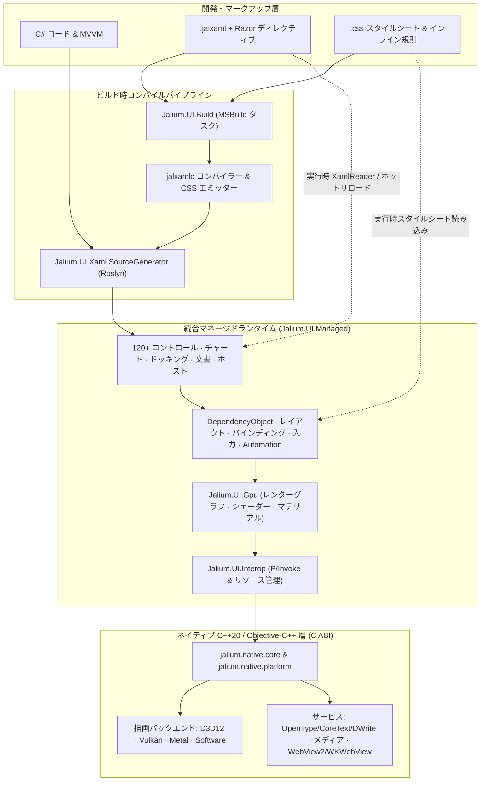

<div align="center">


# Jalium.UI

**.NET 10 向け GPU アクセラレーション クロスプラットフォーム UI フレームワーク**

**C#**、**Razor 対応 JALXAML**、**CSS スタイル＆レイアウト**で **Windows**、**macOS**、**Linux**、**Android** のネイティブ描画を提供し、**iOS/iPadOS**・**tvOS** 開発ホストと **visionOS** ネイティブビルド経路も備えます。

[](https://www.nuget.org/packages/Jalium.UI)
[](https://github.com/VeryJokerJal/Jalium.UI/releases/latest)
[](https://dotnet.microsoft.com/)
[](https://github.com/VeryJokerJal/Jalium.UI/actions/workflows/linux.yml)
[](https://github.com/VeryJokerJal/Jalium.UI/actions/workflows/apple.yml)
[](https://github.com/VeryJokerJal/Jalium.UI/blob/master/LICENSE)
[](https://deepwiki.com/VeryJokerJal/Jalium.UI)

[English](https://github.com/VeryJokerJal/Jalium.UI/blob/master/README.md) · [简体中文](https://github.com/VeryJokerJal/Jalium.UI/blob/master/README.zh-CN.md) · **日本語** · [한국어](https://github.com/VeryJokerJal/Jalium.UI/blob/master/README.ko.md)

[概要](#概要) · [プラットフォーム](#プラットフォームと開発状況) · [アーキテクチャ](#アーキテクチャ) · [機能概要](#機能概要) · [クイックスタート](#クイックスタート) · [ビルド](#ソースからのビルド) · [テスト](#テストと検証) · [ドキュメント](#ドキュメント)

</div>

---

## 概要

**Jalium.UI** は WPF に近いプログラミングモデルと、独自のマネージドビジュアルツリーおよびネイティブ描画バックエンドを組み合わせています。C#、宣言的な `.jalxaml`、または両者を使ってアプリケーションを作成し、CSS でスタイルとレイアウトを追加できます。

<table>
  <tr>
    <td width="50%" valign="top">
      <h3>使い慣れたモデル</h3>
      <p>依存関係プロパティ（<code>DependencyObject</code>）、ルーティングイベント、データバインディング、コマンド、リソース、スタイル、コントロール/データテンプレート、MVVM。</p>
    </td>
    <td width="50%" valign="top">
      <h3>マルチバックエンドネイティブ描画</h3>
      <p>Direct3D 12、Vulkan、Metal、CPU ソフトウェアバックエンドと Impeller / Vello パスエンジンによるベクター、テキスト、アニメーション、リキッドグラス、背景ぼかし、カスタム HLSL シェーダー。</p>
    </td>
  </tr>
  <tr>
    <td width="50%" valign="top">
      <h3>宣言的な JALXAML + Razor + CSS</h3>
      <p><code>.jalxaml</code> での Razor 式と制御フロー（<code>@if</code>、<code>@for</code>、<code>@foreach</code>）、ビューポート再利用（<code>@virtualize</code>）、コードビハインド生成、ビルド時/実行時 CSS。</p>
    </td>
    <td width="50%" valign="top">
      <h3>120+ コントロールと可視化</h3>
      <p><code>DataGrid</code>、<code>TreeDataGrid</code>、<code>DockLayout</code>、<code>Ribbon</code>、<code>NavigationView</code>、15+ 種のチャート、<code>RichTextBox</code>、<code>EditControl</code>、<code>Markdown</code>、<code>DiffViewer</code>、<code>HexEditor</code>、<code>Terminal</code>、<code>InkCanvas</code>、<code>WebView</code>。</p>
    </td>
  </tr>
  <tr>
    <td width="50%" valign="top">
      <h3>標準 .NET ホスト</h3>
      <p><code>AppBuilder</code> は <code>IHostApplicationBuilder</code> を実装し、DI、構成、ログ、Options、メトリクス、ホストサービスを標準統合。</p>
    </td>
    <td width="50%" valign="top">
      <h3>診断、ホットリロード、アクセシビリティ</h3>
      <p>明示的に有効化する DevTools、デバッグ HUD、ホットリロード、ヘッドレス描画スナップショット、Windows UIA / macOS AppKit AX / Linux AT-SPI2 ブリッジ。</p>
    </td>
  </tr>
</table>

---

## プラットフォームと開発状況

> [!IMPORTANT]
> 現在のソースバージョンは **26.11.0** で、[`Directory.Build.props`](https://github.com/VeryJokerJal/Jalium.UI/blob/master/Directory.Build.props) に定義されています。開発は継続中です。すべての `Jalium.UI.*` パッケージのバージョンを揃えてください。ソース実装、パッケージ構成、検証範囲はそれぞれ異なります。

| プラットフォーム | アプリケーションの入口 | ネイティブホストと描画 | 範囲 |
| --- | --- | --- | --- |
| **Windows 10/11** | `Jalium.UI.Desktop` · `net10.0-windows` | Win32 · D3D12、ソフトウェア、任意の Vulkan | ネイティブソリューションの主対象は `win-x64`。`win-arm64` のアセット構成もありますが、検証範囲は異なります |
| **macOS 15+** | `Jalium.UI.MacOS` · `net10.0-macos` · `osx-arm64`、`osx-x64` | AppKit · Metal、ソフトウェア · CoreText | Apple Silicon および Intel x64 ホストと Gallery。[macOS ガイド](https://github.com/VeryJokerJal/Jalium.UI/blob/master/docs/macos-development.md)と固定 Apple ツールチェーンを使用 |
| **Linux デスクトップ** | `Jalium.UI.Linux` · `net10.0` | X11 / Wayland · Vulkan、ソフトウェア | glibc/musl の x64/Arm64 構成。RID とデスクトップの範囲は[検証マトリックス](https://github.com/VeryJokerJal/Jalium.UI/blob/master/docs/linux-parity-status.md)を参照 |
| **Android 7.0+ / API 24+** | `Jalium.UI.Android` · `net10.0-android` | Android Activity · Vulkan、ソフトウェア | `arm64-v8a` と `x86_64` のペイロード。Activity とシステムライフサイクルから起動 |
| **iOS / iPadOS 18+** | `Jalium.UI.iOS` · `net10.0-ios` | UIKit Scene · 静的リンク Metal | 開発中の入口と Arm64 実機/シミュレーターのビルド経路。実機と配布の受け入れ検証は別途必要 |
| **tvOS 18+** | `Jalium.UI.tvOS` · `net10.0-tvos` | UIKit Scene、リモコン/フォーカス統合 · 静的リンク Metal | 開発中の入口と Arm64 実機/シミュレーターのビルド経路。デスクトップと同等の検証を意味しません |
| **visionOS 2+（ネイティブ）** | ネイティブ C ABI / XCFramework スライス。マネージド入口なし | UIKit 系ホスト · Metal | Arm64 実機/シミュレータープリセットとネイティブ検証のみ。マネージドアプリ TFM は未定義 |

表ではアプリケーションプラットフォームとネイティブのみの開発対象を区別しています。定義は [`src/packaging`](https://github.com/VeryJokerJal/Jalium.UI/tree/master/src/packaging) と [`CMakePresets.json`](https://github.com/VeryJokerJal/Jalium.UI/blob/master/src/native/CMakePresets.json) を参照してください。宣言された最低 OS バージョンは、その OS での受け入れ検証記録ではありません。

WPF の多くの概念を採用していますが、移植時には使用する API と動作を確認してください。プラットフォーム固有のコントロール、コーデック、ウィンドウ操作、アクセシビリティは各ネイティブ実装に依存します。

### ランタイム識別子、CPU、配置

| 対象 | RID / ネイティブ ABI | 配置モデル |
| --- | --- | --- |
| **Windows x64 / Arm64** | `win-x64`、`win-arm64` | マネージドアプリと対応 DLL。Windows NativeAOT/静的リンクは別経路。ARM64 アセットは完全なペイロードがある場合のみ梱包 |
| **macOS Apple Silicon / Intel** | `osx-arm64`、`osx-x64` | AppKit `.app` と対象アーキテクチャの dylib/Metal リソース。SDK は選択された `RuntimeIdentifier` に一致する単一アーキテクチャのペイロードを検証・配置 |
| **Linux glibc x64 / Arm64** | `linux-x64`、`linux-arm64` | リリース基準は glibc 2.31 / `GLIBCXX_3.4.28`。X11/Wayland とシステム依存は必要 |
| **Linux musl x64 / Arm64** | `linux-musl-x64`、`linux-musl-arm64` | 対応する musl ホスト/ペイロード。glibc と別アセットで、検証範囲は RID に依存 |
| **Android Arm64 / x64** | `android-arm64` → `arm64-v8a`、`android-x64` → `x86_64` | Activity/APK に ABI 別 `.so` と `libc++_shared.so` を梱包。ネイティブパッケージには両 ABI が必要 |
| **iOS / iPadOS** | `ios-arm64`、`iossimulator-arm64` | UIKit アプリに静的 `JaliumNative.xcframework`、`.metallib`、対応する実機/シミュレータースライスを配置 |
| **tvOS** | `tvos-arm64`、`tvossimulator-arm64` | UIKit/リモコンフォーカスのアプリと静的 XCFramework/Metal リソース |
| **visionOS ネイティブ検証** | `visionos-arm64`、`visionossimulator-arm64` | リポジトリ独自のネイティブスライス識別子。NuGet アプリ RID やマネージド TFM ではありません |

共通コントロール、バインディング、リソース、MVVM、JALXAML、実装済み CSS は再利用できます。各アプリは対応する TFM、入口、ネイティブペイロード、権限、ライフサイクル統合を用意します。自己完結/単一ファイル発行でも、ウィンドウシステム、コーデック、ドライバーの依存は残ります。Windows/Linux NativeAOT、macOS アプリバンドル、組み込み Apple 静的リンクの検証範囲は別々です。

### デスクトップ統合マトリックス

実装済みの経路を示します。任意のシステムサービスと下記の検証範囲も考慮してください。

| 機能 | Windows | macOS | Linux |
| --- | --- | --- | --- |
| **描画とテキスト** | D3D12、任意の Vulkan、ソフトウェア、Windows テキストサービス | Metal、ソフトウェア、CoreText、Retina | Vulkan、ソフトウェア、独自 OpenType、Fontconfig |
| **入力とデータ交換** | キーボード/IME、ポインター/タッチ/ペン、Win32 クリップボード、OLE ドラッグ | AppKit responder/IME、ジェスチャー/タブレット、NSPasteboard、ネイティブドラッグ | X11/XIM/XInput2、Wayland text-input/タッチ/タブレット、多形式クリップボード/ドラッグ |
| **ファイルダイアログ** | Windows/COM の開く/保存/フォルダー選択 | `NSOpenPanel` / `NSSavePanel` | xdg-desktop-portal FileChooser。セッションサービスとデスクトップバックエンドが必要 |
| **印刷** | Windows 印刷ダイアログとキュー API | 共通 `PrintDialog` にアダプターなし | Print portal に PDF を送信。キュー管理は Windows のみ |
| **埋め込みブラウザー** | WebView2。ランタイムが必要 | WKWebView ネイティブアダプター。統合検証は別途管理 | リポジトリ内にネイティブブラウザーバックエンドなし |
| **アクセシビリティ** | Windows UIA Peer/ブリッジ | AppKit Peer/ブリッジ | accessibility bus の AT-SPI2 |
| **システム通知** | WinRT Toast アダプター | 組み込み `SystemNotificationManager` アダプターなし | libnotify / デスクトップ通知サービス |
| **シェルターミナル** | ConPTY | POSIX PTY | POSIX PTY |

`NotifyIcon` に現在具体的に実装されているのは Linux StatusNotifierItem です。Windows 形式の API だけで Windows/macOS トレイ実装の完了は判断できません。macOS Dock/タスクバーは別 API です。`WindowsFormsHost` は Windows 専用です。Jalium 内のダイアログ、フライアウト、Toast は OS ネイティブダイアログ/通知とは別です。

### モバイル・テレビ統合マトリックス

| 機能 | Android | iOS / iPadOS 開発入口 | tvOS 開発入口 |
| --- | --- | --- | --- |
| **ホストとライフサイクル** | `JaliumActivity`、SurfaceView/JNI、Surface 交換、Activity | `JaliumIOSApplicationDelegate`、UIKit Scene、セーフエリア/方向、アプリライフサイクル | `JaliumTVApplicationDelegate`、UIKit Scene、リモコン/フォーカス |
| **入力** | タッチ/ペン、ハードウェアキー、InputConnection、ソフトキーボード | タッチ/Pencil サンプル転送、`UIKeyInput`、キーボード領域/セーフエリア | リモコン方向/選択/メニュー/再生停止キー、フォーカスナビゲーション |
| **クリップボード** | JNI プレーンテキスト。汎用多形式 get/set は未対応を返す | UIKit pasteboard テキスト/データ | 入口は未対応を返す |
| **メディア** | ネイティブ画像/動画/カメラ、MediaCodec、対応 GPU surface。実機/API/権限に依存 | Apple 画像/動画/キャプチャ。実機と権限に依存 | Apple 画像/動画再生。カメラ/マイク取得は未実装を返す |
| **埋め込みブラウザー** | リポジトリ内にバックエンドなし | WKWebView ネイティブアダプター | 入口は未実装を返す |
| **システム通知** | マネージドアダプターは存在。必要な通知ヘルパーのエクスポートは現 Android ネイティブソースにない | 組み込み通知アダプターなし | 組み込み通知アダプターなし |

共通 Automation Peer モデルは Android TalkBack / UIKit 専用エクスポートではなく、現デスクトップブリッジはそれらのモバイルアダプターを提供しません。デスクトップのファイル選択、印刷キュー、トレイ、自由配置ウィンドウをモバイル機能とみなさないでください。iOS/tvOS アプリには自身の bundle、delegate、署名/provisioning、リソース、実機検証が必要です。

### 実行時選択と現在の範囲

- 対応するバックエンドがある場合、`JALIUM_RENDER_BACKEND=auto`、`d3d12`、`vulkan`、`metal`、`software` を指定できます。`JALIUM_WINDOW_SYSTEM=auto|x11|wayland` は Linux 専用です。ソフトウェア描画にも動作するホスト/表示環境が必要です。
- Linux Vulkan には対応 loader/driver、ソフトウェア表示には X11/Wayland が必要です。必要なメディア機能で GStreamer/コーデックを読み込みます。portal、D-Bus、アクセシビリティ、通知、CJK フォントは機能ごとの依存です。
- Wayland は compositor が提供する scale/viewport プロトコルを利用します。グローバル座標、最前面、ウィンドウ全体の不透明度、強制アクティブ化は compositor の制約を受け、X11 と同じ機能ではありません。
- macOS のプリセットは `osx-arm64` と `osx-x64` を対象とします。Intel Apple シミュレーター、Windows x86、Android Arm32、Linux Arm32、ブラウザー/WebAssembly は記載したアプリ/パッケージ対象外です。他 Unix の条件分岐だけではホスト/RID のあるリリース対象になりません。
- カメラ/マイク、GPU 動画取り込み、IME、ペン/タッチ、支援技術、ストア/配布の検証は OS、権限、実機、ドライバーに依存します。[Linux マトリックス](https://github.com/VeryJokerJal/Jalium.UI/blob/master/docs/linux-parity-status.md)と [macOS 記録](https://github.com/VeryJokerJal/Jalium.UI/blob/master/docs/macos-window-behavior.md)にリビジョン別の証拠と残項目があります。

---

## アーキテクチャ

### 実行とビルドの流れ



ソースはサブシステム別に配置されていますが、Core、Media、Input、Interop、Controls の大部分は **`Jalium.UI.Managed`** にまとめてコンパイルされます。互換アセンブリは型転送によって公開パッケージ/名前空間を維持し、実装の重複を避けています。

### マネージドパッケージとツール

| コンポーネント | 役割 |
| --- | --- |
| `Jalium.UI.Managed` | 依存関係プロパティ、レイアウト、バインディング、入力、描画、コントロール、ホスト、Automation の統合実装 |
| `Jalium.UI.Core`、`.Media`、`.Input`、`.Controls` | 型転送で統合実装に接続する互換ファサード |
| `Jalium.UI.Interop` | 相互運用 API ファサード、ネイティブアセット、配置統合 |
| `Jalium.UI.Gpu` | GPU リソース、レンダーグラフ、マテリアル、シェーダー、描画抽象 |
| `Jalium.UI.Xaml` | JALXAML 読み込み、マークアップ拡張、Razor 実行時機能、リソース、ホットリロード |
| `Jalium.UI.Build` | JALXAML、CSS、シェーダー、ネイティブ、AOT を統合する MSBuild タスク/targets |
| `Jalium.UI.Xaml.SourceGenerator` | ビュー、バインディング、マークアップ変換を生成する Roslyn アナライザー/ジェネレーター |
| `Jalium.UI` | 共通依存メタパッケージ。アプリケーション側でプラットフォーム入口を選択 |
| `Jalium.UI.Compiler` | ビルドツール用のポータブルな `jalxamlc` 実行プログラム。独立した NuGet パッケージではありません |
| `Jalium.UI.Css.Tooling` | 内部用 Node Sass/Less/Prettier ヘルパー。公開 NuGet パッケージではなく、通常の CSS 作成には不要 |

### ネイティブモジュール

| モジュール | 役割 |
| --- | --- |
| `jalium.native.core` | C ABI、描画コンテキスト、バックエンド登録、共通ランタイム契約 |
| `jalium.native.platform` | ネイティブウィンドウ、イベント、入力、クリップボード、プラットフォーム統合 |
| `jalium.native.d3d12` / `.vulkan` / `.metal` / `.software` | GPU / CPU 描画バックエンド |
| `jalium.native.text` | Linux/Android 向け独自 OpenType シェーピング/ラスタライズ。Linux のフォント探索には Fontconfig を使用 |
| `jalium.native.media.core` | 共通メディア ABI とオーディオ実装 |
| `jalium.native.media.windows` | Media Foundation / WIC 統合 |
| `jalium.native.media.linux` | 動的に読み込む GStreamer 統合 |
| `jalium.native.media.android` | Android ネイティブメディア、画像、カメラ統合 |
| `jalium.native.media.apple` | AVFoundation、VideoToolbox、ImageIO、Apple メディアサービス |
| `jalium.native.browser` / `.browser.apple` | Windows WebView2 / Apple WebKit 統合。利用可否はプラットフォームに依存 |
| `jalium.native.aot` | NativeAOT と Apple 組み込みプラットフォーム用の静的ネイティブ集約層 |

GPU バックエンド（D3D12/Vulkan/Metal）とパス描画エンジン（`RenderingEngine.Impeller` / `RenderingEngine.Vello`）は別に選択します。利用可能なエンジンとエフェクトの範囲はバックエンドに依存します。

---

## 機能概要

| 領域 | 例 |
| --- | --- |
| **レイアウト** | `Grid`、`StackPanel`、`Canvas`、`DockPanel`、`WrapPanel`、`UniformGrid`、`FlexPanel`、`Viewbox`、`ScrollViewer`、`Expander`、`GroupBox`、`Splitter`、`DockLayout`、仮想化パネル、CSS block/flex/grid |
| **入力コントロール** | `Button`、`RepeatButton`、`ToggleButton`、`SplitButton`、`HyperlinkButton`、`TextBox`、`PasswordBox`、`NumberBox`、`AutoCompleteBox`、`ComboBox`、`CheckBox`、`RadioButton`、`ToggleSwitch`、`Slider`、`RangeSlider`、`Calendar`、`DatePicker`、`TimePicker`、`ColorPicker`、`Thumb` |
| **データとナビゲーション** | `DataGrid`、`TreeDataGrid`、`ListView`、`ListBox`、`TreeView`、`TreeSelector`、`PropertyGrid`、`JsonTreeViewer`、`NavigationView`、`Frame`、`TabControl`、`Ribbon`、`MenuBar`、`Menu`、`ContextMenu`、`MenuFlyout`、`CommandBar`、`CommandBarFlyout`、`ToolBar`、`SwipeControl`、`StatusBar`、`InfoBar` |
| **文書とエディター** | `RichTextBox`、`EditControl`、`FlowDocument` ビューアー、`DocumentViewer`、`Markdown`、`DiffViewer`、`HexEditor`、`Terminal` |
| **可視化** | `LineChart`、`BarChart`、`PieChart`、`ScatterPlot`、`CandlestickChart`、`Heatmap`、`Sparkline`、`GaugeChart`、`TreeMap`、`GanttChart`、`NetworkGraph`、`SankeyDiagram`、`Flowchart`、`MapView`、`MiniMap`、`GeographicHeatmap` |
| **メディアと統合** | `Image`、GIF/APNG/アニメーション WebP、`MediaElement`、`CameraView`、`WebView`、`InkCanvas`、`QRCode`、`IconElement`、`ContentDialog`、`Popup`、`ToolTip`、`ToastNotification`、`SystemNotification`、`NotifyIcon`、`TitleBar`、印刷、Windows 専用 `WindowsFormsHost` |
| **グラフィックス** | パス、ブラシ、変換、クリップ、影、ぼかし、Acrylic/Mica、リキッドグラス、トランジション、カスタム HLSL シェーダー |

### テキスト、入力、アクセシビリティ

- 書記素クラスタ単位のキャレット移動、選択、削除、IME 合成入力、リッチ文書編集、エンコーディング対応のファイル/ターミナル処理。
- Windows テキストサービス、Apple CoreText、Linux/Android 独自 OpenType エンジンを使用。フォントフォールバック、カラーグリフ、アンチエイリアスはプラットフォーム/バックエンドで異なります。
- マウス、キーボード、タッチ、ペン、ジェスチャー、操作慣性、スクロールをマネージド入力系へルーティング。実機検証は合成イベントのテストと区別して記録します。
- Automation Peer は Windows UIA、Linux AT-SPI、macOS アクセシビリティに接続。Peer/ブリッジの実装範囲だけではスクリーンリーダー検証の完了を意味しません。

### メディアとエフェクト

オーディオはネイティブ再生、WAV/FLAC/MP3/Vorbis、プラットフォームコーデック、音程を保つ速度変更に対応します。動画はネイティブデコーダーと `NativeVideoSurface` を使用し、CPU フレームまたは対応する外部 GPU リソースを受け取ります。GPU インポート/ゼロコピーの可否はバックエンド、形式、デコーダー、ドライバー次第です。[Linux メディアの範囲](https://github.com/VeryJokerJal/Jalium.UI/blob/master/docs/linux.md#media)を参照してください。

対応バックエンドでは HLSL を利用できます。macOS では `PixelShader.SourceHlsl` を使い、DXC と SPIRV-Cross で Metal 向けに変換します。DirectX バイトコードは Windows 固有です。[Metal エフェクトと検証](https://github.com/VeryJokerJal/Jalium.UI/blob/master/docs/macos-development.md#metal-shader-effects)を参照してください。

### ホストと診断

`AppBuilder` は `IHostApplicationBuilder` を実装します。`Build()` 前にサービス、ログ、Options、View/ViewModel を登録します。返される `JaliumApp` がホストとアプリケーションを管理し、`Run()` がサービス開始、UI ループ、終了時の停止を行います。AppKit、Android、UIKit は各プラットフォームのライフサイクルホストを使用します。

`Jalium.UI.Hosting` の拡張には `AddView<TView, TViewModel>`、`ConfigureJalium()`、`UseJaliumMetrics()`、`UseDevTools()`、`UseDebugHud()` があります。DevTools/HUD は明示的に有効化し、ツリー/プロパティ、レイアウト/バインディング/イベント、描画メトリクス、オーバーレイを確認できます。ホットリロードは名前付きパイプで JALXAML 更新を受信し、独立した起動/監視ツールは `tools/Jalium.UI.HotReload.Watcher` にあります。

生成済みマークアップと明示的なビュー登録はトリミング/AOT に役立ちます。実行時解析やリフレクションによる探索は、アプリケーションごとの検証が必要です。

---

## インストール

対象プラットフォームの入口パッケージを選択してください。

```bash
dotnet add package Jalium.UI.Desktop --version 26.11.0   # Windows
dotnet add package Jalium.UI.Linux --version 26.11.0     # Linux
dotnet add package Jalium.UI.MacOS --version 26.11.0     # macOS
dotnet add package Jalium.UI.Android --version 26.11.0   # Android
```

対象のコマンドを一つだけ実行し、表に従ってターゲットフレームワークと必要な .NET workload を設定します。共有ライブラリは `Jalium.UI` を参照でき、最終アプリケーションがプラットフォーム入口を提供します。iOS/tvOS 開発ではソースプロジェクトと静的ネイティブペイロードを使用します。

---

## クイックスタート

### 1. C# デスクトップアプリケーション

Windows 上の空のディレクトリに `HelloJalium.csproj` を作成します。

```xml
<Project Sdk="Microsoft.NET.Sdk">
  <PropertyGroup>
    <OutputType>WinExe</OutputType>
    <TargetFramework>net10.0-windows</TargetFramework>
    <ImplicitUsings>enable</ImplicitUsings>
    <Nullable>enable</Nullable>
  </PropertyGroup>
  <ItemGroup>
    <PackageReference Include="Jalium.UI.Desktop" Version="26.11.0" />
  </ItemGroup>
</Project>
```

`Program.cs` を追加します。STA の入口は COM クリップボードやダイアログなどの Windows デスクトップサービスに必要です。

```csharp
using Jalium.UI;
using Jalium.UI.Controls;

internal static class Program
{
    [STAThread]
    private static int Main(string[] args)
    {
        var builder = AppBuilder.CreateBuilder(args);
        builder.ConfigureApplication(app =>
        {
            var greeting = new TextBlock { Text = "Hello, Jalium.UI", FontSize = 28 };
            var button = new Button
            {
                Content = "Click me",
                Margin = new Thickness(0, 16, 0, 0)
            };
            button.Click += (_, _) => greeting.Text = "Welcome to Jalium.UI!";

            app.MainWindow = new Window
            {
                Title = "Hello Jalium.UI",
                Width = 800,
                Height = 500,
                Content = new StackPanel
                {
                    Margin = new Thickness(24),
                    Children = { greeting, button }
                }
            };
        });

        using var host = builder.Build();
        return host.Run();
    }
}
```

そのディレクトリで実行します。

```bash
dotnet run -c Release
```

Linux では `net10.0` と `Jalium.UI.Linux` に変更し、同じアプリケーションコードを利用できます。[Linux ガイド](https://github.com/VeryJokerJal/Jalium.UI/blob/master/docs/linux.md#runtime-dependencies)の依存関係を導入してください。macOS/Android には AppKit/Activity の入口が必要です。下記のサンプルとガイドを参照してください。

### 2. JALXAML

```xml
<Window xmlns="http://schemas.microsoft.com/winfx/2006/xaml/presentation"
        Title="JALXAML Window" Width="800" Height="500">
    <StackPanel Margin="24">
        <TextBlock Text="Hello from JALXAML" FontSize="28" />
        <Button Content="Start" Margin="0,16,0,0" />
    </StackPanel>
</Window>
```

生成ビューでは `x:Class`、対応する partial コードビハインド、コンストラクターからの `InitializeComponent()` 呼び出しを追加します。`Jalium.UI.Build` が `.jalxaml` を検出し、変換したマークアップをジェネレーターに渡します。`Jalium.UI.Markup.XamlReader.Parse(...)` による実行時読み込みも可能です。上記の `ConfigureApplication` 内で解析した `Window` を設定してください。

### 3. Razor 構文と仮想化リスト

`{Binding ...}` に加えて `@Path`、`@(expr)`、`@{ ... }`、`@if`/`@else`、`@section`/`@RenderSection`、ループ指令を使えます。`$.Path` は要素自身のプロパティ、`#.Path` は `DataContext` のみを参照します。

データコンテキストの `Rows` にバインドするには次を使用します。

```xml
<ScrollViewer Height="360">
    @virtualize(var row in Rows)
    {
        <Border Padding="8"><TextBlock Text="@row.Name" /></Border>
    }
</ScrollViewer>
```

`@virtualize` は表示範囲のコンテナーを再利用し、コレクション変更を追跡します。本体のルートは一要素で、スクロール軸に有限のサイズが必要です。`@foreach` と `@for` は読み込み時に一度展開するため、小さな静的リストに適しています。通知するソースは変更時に更新され、通知しない CLR 値は一度評価されます。変換と実行時の範囲は [Razor リファレンス](https://github.com/VeryJokerJal/Jalium.UI/blob/master/docs/razor-syntax.md)を参照してください。

### 4. CSS スタイル

```xml
<Border xmlns="http://schemas.microsoft.com/winfx/2006/xaml/presentation"
        Css.StyleSheetSource="Styles/App.css" Css.Class="card">
    <TextBlock Text="Styled with CSS" Css.Class="heading" />
</Border>
```

```css
/* Styles/App.css */
.card {
    background-color: #eef6ff;
    border-radius: 12px;
    padding: 24px;
}
.heading {
    color: #175cd3;
    font-size: 28px;
    font-weight: 600;
}
```

`Css.StyleSheetSource` の通常パスは、宣言元 JALXAML のアセンブリのリソースルートを基準にします。マークアップのディレクトリ基準ではありません。既定の targets は `.css` とインライン CSS を登録コードにコンパイルします。実行時スタイルシートと動的バインディングも利用できます。

CSS は実装済みのセレクター、カスケード/レイヤー、カスタムプロパティ、メディア/コンテナークエリー、flex/grid、位置指定、組版、生成コンテンツ、画像、マスク、エフェクトを扱います。Jalium のビジュアル/文書モデルとテンプレート境界に従います。実装構文は `Jalium.UI.Styling.CssAuthoring` または `Css.Supports()` で確認できます。解析成功だけで全バックエンドの描画互換性は保証されません。[CSS の作成と制限](https://github.com/VeryJokerJal/Jalium.UI/blob/master/docs/css-authoring.md)を参照してください。

---

## ソースからのビルド

> [!NOTE]
> コマンドはリポジトリルートから実行します。マネージドコンパイルとネイティブペイロード生成は別の手順で、マネージドビルドだけではネイティブアプリケーションを実行できません。

### 前提条件

| 対象 | 要件 |
| --- | --- |
| **マネージド** | [`global.json`](https://github.com/VeryJokerJal/Jalium.UI/blob/master/global.json) に対応する .NET 10 SDK。最低 `10.0.300`、`latestFeature` ロールフォワード、プレリリース可 |
| **ネイティブ** | CMake **3.28+** と C++20。Apple ソースは Objective-C++ も使用 |
| **Windows ネイティブソリューション** | Visual Studio C++、Windows SDK、**v145** ツールセット、完全なソリューション用の Vulkan SDK |
| **Linux** | Ninja、GCC/Clang、Vulkan ヘッダー/ローダー、X11/Wayland 開発ライブラリ、Fontconfig。[依存関係一覧](https://github.com/VeryJokerJal/Jalium.UI/blob/master/docs/linux.md#build-validate-and-package)を参照 |
| **macOS / Apple** | Apple Silicon または Intel Mac（macOS 15+ ターゲット）、Xcode/Metal ツール、Ninja、Python 3.9+、対象の .NET workload。バージョンは [`eng/apple/toolchain.lock.json`](https://github.com/VeryJokerJal/Jalium.UI/blob/master/eng/apple/toolchain.lock.json) |
| **Android** | .NET Android workload、Android SDK/JDK、標準ヘルパー用 NDK **27.2.12479018** |

Apple ロックは SDK `10.0.302`、workload set `10.0.302.1`、Xcode `26.6` を指定し、一般 SDK の最低要件とは別に管理されます。[Apple 環境ガイド](https://github.com/VeryJokerJal/Jalium.UI/blob/master/docs/macos-development.md#prerequisites)に従って選択してください。

### 共通マネージドライブラリ

```bash
dotnet build src/packaging/Jalium.UI/Jalium.UI.csproj -c Release
```

同時または OS をまたぐビルドには、別々の絶対パスを `-p:JaliumBuildRoot=...` に渡し、`obj`/`bin` を分離します。同じ restore/build/test には同じルートを使用します。既定のソリューションビルドから一部サンプル、ツール、Apple 入口は除外されているため、必要なプロジェクトを明示的にビルドしてください。

### Windows

Visual Studio Developer Command Prompt で実行します。

```powershell
msbuild src/native/Jalium.Native.sln /m /p:Configuration=Release /p:Platform=x64
dotnet run --project samples/Jalium.UI.DesktopDemo/Jalium.UI.DesktopDemo.csproj -c Release
```

### Linux

アーキテクチャと glibc/musl が一致するホストで実行します。

```bash
JALIUM_NATIVE_BUILD_TESTS=1 bash eng/linux/build-native.sh linux-x64 Release
dotnet run --project samples/Jalium.UI.LinuxDemo/Jalium.UI.LinuxDemo.csproj -c Release
```

ヘルパーは `linux-arm64`、`linux-musl-x64`、`linux-musl-arm64` も受け付けます。ホストを検査し、暗黙のクロスコンパイルは行いません。クロスビルドと glibc 基準のヘルパーは `eng/linux` にあります。シェルスクリプトには LF 改行を使用してください。

### macOS

```bash
bash eng/apple/build-native.sh macos Debug --development
```

ネイティブスクリプトは既定で現在のホスト CPU に従います。`JALIUM_APPLE_ARCHITECTURE=arm64|x86_64` で対象アーキテクチャを明示選択できます（クロスアーキテクチャビルドには `--build-only` が必要です）。完全な Gallery を実行するには、[Gallery リポジトリ](https://github.com/VeryJokerJal/Jalium-UI-Gallery)を隣の `Jalium.UI.Gallery` に配置するか `JALIUM_GALLERY_ROOT` を設定し、実行します。

```bash
bash eng/apple/run-gallery.sh Debug
```

このヘルパーはネイティブをビルド/検証し、`.app` を生成して開きます。`--build-only` で起動を省略できます。初回には固定シェーダーコンパイラーを準備します。AppKit principal class、出力先、ツールチェーン上書きは [macOS ガイド](https://github.com/VeryJokerJal/Jalium.UI/blob/master/docs/macos-development.md)を参照してください。

### Android

標準ヘルパーは **Windows NDK ホストツール**を使用します。Git Bash などの Bash 環境で実行してください。

```bash
bash src/native/build-android.sh all
```

`all` は両 ABI をビルドし、完全性スタンプを作成します。単一 ABI は開発用で、完全なパッケージのスタンプを無効化します。NDK は `JALIUM_ANDROID_NDK_VERSION` と `ANDROID_NDK_ROOT` で明示的に変更できます。Activity 入口は `samples/Jalium.UI.AndroidDemo` にあります。

### iOS、iPadOS、tvOS

固定 Xcode/.NET ツールチェーンを持つ Mac で、必要な四つの静的スライスを作成してから XCFramework にまとめます。以下の入口ライブラリのビルドでは、完全な実行可能アプリは作成しません。

```bash
dotnet workload install ios tvos --version 10.0.302.1

bash eng/apple/build-native.sh ios Release
bash eng/apple/build-native.sh iossimulator Release
bash eng/apple/build-native.sh tvos Release
bash eng/apple/build-native.sh tvossimulator Release
bash eng/apple/package-xcframework.sh Release

dotnet build src/packaging/Jalium.UI.iOS/Jalium.UI.iOS.csproj -c Release -r ios-arm64
dotnet build src/packaging/Jalium.UI.tvOS/Jalium.UI.tvOS.csproj -c Release -r tvos-arm64
```

シミュレーターの入口ライブラリには、対応プロジェクトで `iossimulator-arm64` または `tvossimulator-arm64` を選びます。アプリは `JaliumIOSApplicationDelegate` / `JaliumTVApplicationDelegate` を継承し、`CreateHostedApp()` とプラットフォーム Scene のライフサイクルを使用します。`.metallib`/manifest と XCFramework スライスを一致させてください。JALXAML を作成するアプリは前述のビルド/ソースジェネレーター統合も必要です。実機用 bundle と署名/provisioning はアプリ側のビルドで行います。

### visionOS ネイティブスライス

必要な iOS/tvOS スライスの準備後、任意で visionOS スライスを追加して XCFramework を再生成できます。

```bash
bash eng/apple/build-native.sh visionos Release
bash eng/apple/build-native.sh visionsimulator Release
bash eng/apple/package-xcframework.sh Release
```

`visionsimulator` 引数は `apple-visionossimulator-arm64` プリセットを選びます。ネイティブ Metal/プラットフォーム/メディア検証のための経路であり、`Jalium.UI.visionOS` プロジェクトやマネージドアプリのビルドコマンドはありません。

### パッケージングと NativeAOT

```bash
dotnet pack src/packaging/Jalium.UI/Jalium.UI.csproj -c Release -o artifacts/nuget
```

これは共通メタパッケージを作成し、プラットフォーム配布全体は作成しません。プラットフォームのパッケージングには対応ネイティブペイロード、エクスポート検査、完全性/由来スタンプが必要です。ネイティブ出力は `src/native/bin/native/<rid>/<Configuration>`、Apple 静的スライス/XCFramework は `src/native/artifacts/apple` に配置されます。構成を合わせ、ABI 変更後は再生成してください。

Windows/Linux NativeAOT と Apple 静的リンクは別々に実装されています。`samples/Jalium.UI.AotWindowDemo`、`eng/linux/test-native-aot-static.sh`、`eng/apple/package-xcframework.sh`、[リリースワークフロー](https://github.com/VeryJokerJal/Jalium.UI/tree/master/.github/workflows)を参照してください。

---

## テストと検証

対象ホストに対応するスイートを選び、必要なネイティブペイロードを用意してください。

```bash
# ポータブルな生成テンプレート契約
dotnet test tests/Jalium.UI.Template.Tests/Jalium.UI.Template.Tests.csproj -c Release

# Windows マネージドスイート
dotnet test tests/Jalium.UI.Tests/Jalium.UI.Tests.csproj -c Release

# Linux ポータブル/マネージドスイート
dotnet test tests/Jalium.UI.Linux.Tests/Jalium.UI.Linux.Tests.csproj -c Release

# macOS マネージド契約。対応する Debug ネイティブペイロードが必要
dotnet test tests/Jalium.UI.MacOS.Tests/Jalium.UI.MacOS.Tests.csproj -c Debug
```

ネイティブ CTest は描画読み戻し、テキスト、エフェクト、メディア、ウィンドウ/入力ライフタイム、プラットフォーム統合を検証します。Linux 統合には対象 compositor/display、D-Bus、テスト依存関係が必要です。Apple ウィンドウ検証は独立した `Jalium.UI.MacOS.HostSmoke` AppKit ホスト、動画相互運用テストは CMake 製 shim を使用します。NuGet 消費側プロジェクトは準備済みのフィードが必要で、既定のソリューション restore に含まれません。

[Linux](https://github.com/VeryJokerJal/Jalium.UI/actions/workflows/linux.yml)、[Apple](https://github.com/VeryJokerJal/Jalium.UI/actions/workflows/apple.yml)、[D3D12 インク](https://github.com/VeryJokerJal/Jalium.UI/actions/workflows/d3d12-ink.yml)、Windows 契約ワークフローはそれぞれ独自のゲートを定義します。テストの存在や限定スイートの成功は、全回帰テストの成功を意味しません。実 GPU/実機、実 IME、スクリーンリーダー、配布は別途検証し、残項目と結果の対象リビジョンはプラットフォーム記録を確認してください。

---

## サンプルと Gallery

| 場所 | 目的 |
| --- | --- |
| [独立 Gallery](https://github.com/VeryJokerJal/Jalium-UI-Gallery) | デスクトップ、macOS、Linux、Android、Headless CLI 入口を持つ完全な 128 ページのコントロール/エフェクト展示 |
| `samples/Jalium.UI.DesktopDemo` | C# Windows アプリとネイティブ統合 |
| `samples/Jalium.UI.HostingDemo` | DI、MVVM、ログ、構成、Options、メトリクス、ホストサービス |
| `samples/Jalium.UI.LinuxDemo` | Linux ウィンドウ、クリップボード、ダイアログ、入力、バックエンド選択 |
| `samples/Jalium.UI.AndroidDemo` | Android Activity とネイティブライブラリ配置 |
| `samples/Jalium.UI.AotWindowDemo` | Windows NativeAOT アプリ |
| `samples/Jalium.UI.BorderlessDemo`、`.TransparentBackdropDemo`、`.MillionScroll` | ウィンドウ枠、透過背景、仮想化スクロール実験 |
| `samples/Jalium.UI.Gallery` | 小規模なリポジトリ内 Windows サンプル。完全な Gallery は上記の別リポジトリで管理 |

Gallery のダウンロードは [GitHub Releases](https://github.com/VeryJokerJal/Jalium.UI/releases) を参照し、各リリースの環境要件、署名、検証範囲を確認してください。

---

## リポジトリ構成

```text
src/managed/       ランタイム、互換ファサード、XAML/GPU/ビルドツール
src/native/        C/C++/Objective-C++、シェーダー、プリセット、外部ソース
src/packaging/     共通/プラットフォーム入口パッケージ (Windows, Linux, macOS, Android, iOS, tvOS)
samples/           リポジトリ内アプリケーションとサンプル
tests/             マネージドスイート、ネイティブ統合ホスト、NuGet 消費側
eng/apple/         Apple ツールチェーン、シェーダー、パッケージ/検証ヘルパー
eng/linux/         Linux ビルド、ABI 基準、統合/パッケージ検証
eng/msbuild/       ネイティブペイロードの鮮度/由来ガード
eng/release/       リリースパッケージングと由来確認ツール
tools/             ホットリロード監視、API 検証、ソースデータ生成
docs/              構文、描画、プラットフォーム動作、検証ガイド
```

---

## ドキュメント

| ガイド | 内容 |
| --- | --- |
| [CSS 作成](https://github.com/VeryJokerJal/Jalium.UI/blob/master/docs/css-authoring.md) | スタイルシート、メタデータ、レイアウト/テキスト/描画の実装範囲と制限 |
| [Razor 構文](https://github.com/VeryJokerJal/Jalium.UI/blob/master/docs/razor-syntax.md) | 式、指令、仮想化、変換規則 |
| [描画 API](https://github.com/VeryJokerJal/Jalium.UI/blob/master/docs/drawing-api.md) | 描画コンテキストと GPU エフェクト |
| [macOS 開発](https://github.com/VeryJokerJal/Jalium.UI/blob/master/docs/macos-development.md) | ツールチェーン、AppKit、Gallery、Metal エフェクト、テスト |
| [macOS ウィンドウ動作](https://github.com/VeryJokerJal/Jalium.UI/blob/master/docs/macos-window-behavior.md) | ウィンドウ/入力/アクセシビリティ実装と受け入れ記録 |
| [macOS パス描画](https://github.com/VeryJokerJal/Jalium.UI/blob/master/docs/macos-path-rendering.md) | パス描画構成と検証 |
| [Linux デスクトップ](https://github.com/VeryJokerJal/Jalium.UI/blob/master/docs/linux.md) | 依存関係、ウィンドウ、メディア、パッケージ、制限 |
| [Linux 検証マトリックス](https://github.com/VeryJokerJal/Jalium.UI/blob/master/docs/linux-parity-status.md) | RID/機能の証拠と未検証項目 |
| [Linux ウィンドウ動作](https://github.com/VeryJokerJal/Jalium.UI/blob/master/docs/linux-window-behavior.md) | 現在のウィンドウ/入力動作と回帰記録 |
| [Markdown 構文](https://github.com/VeryJokerJal/Jalium.UI/blob/master/docs/markdown-syntax.md) / [スタイル](https://github.com/VeryJokerJal/Jalium.UI/blob/master/docs/markdown-styling.md) | Markdown コントロールの内容と外観 |
| [手動ビルド設定](https://github.com/VeryJokerJal/Jalium.UI/blob/master/docs/manual-build-configuration.md) | 追加設定と問題調査。通常は標準プラットフォームヘルパーを優先 |
| [Gallery 起動性能](https://github.com/VeryJokerJal/Jalium.UI/blob/master/docs/gallery-startup-performance.md) | トレース、基準、準備完了時間 |
| [API 互換検証ツール](https://github.com/VeryJokerJal/Jalium.UI/blob/master/tools/Jalium.UI.ApiParity/README.md) | 対応セルフテストと過去データの要件。現行 WPF 互換性の認証ではありません |

---

## コントリビューションとコミュニティ

Issue/PR を歓迎します。対象プラットフォーム/バックエンド、最小の再現例、期待動作、検証手順を記載してください。描画/入力の変更には対応するネイティブ経路の証拠と、未検証の実機/操作を明記してください。

コミュニティ QQ グループ：**1079778999**。

## ライセンス

Jalium.UI は [MIT](https://github.com/VeryJokerJal/Jalium.UI/blob/master/LICENSE) ライセンスです。同梱依存にはそれぞれの条件が適用されます。[第三者ライブラリ一覧](https://github.com/VeryJokerJal/Jalium.UI/blob/master/src/native/thirdparty/LICENSES.md)と各ネイティブペイロードのライセンスを参照してください。
