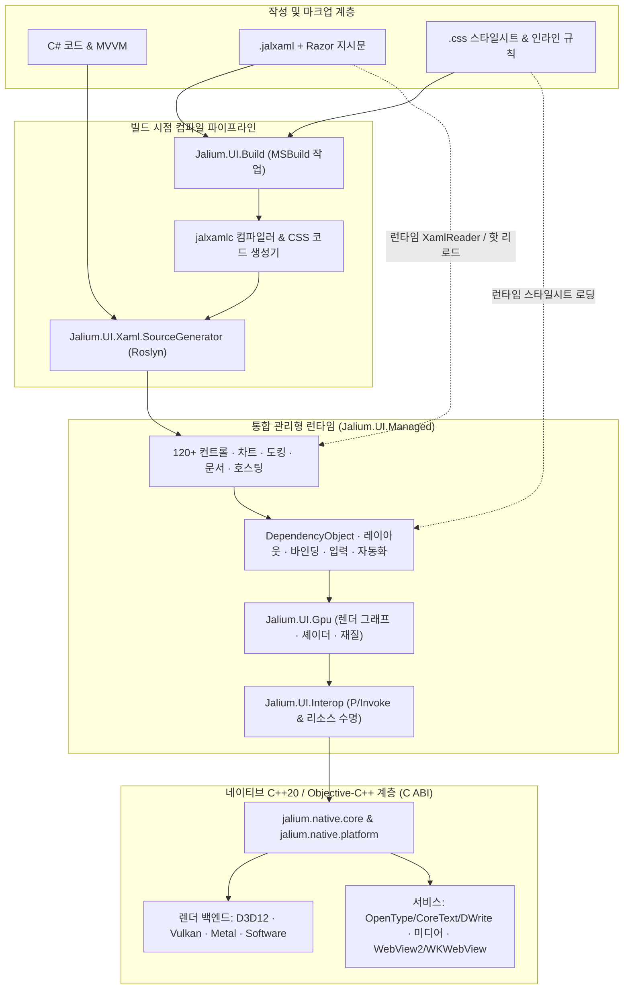

<div align="center">


# Jalium.UI

**.NET 10용 GPU 가속 크로스 플랫폼 UI 프레임워크**

**C#**, **Razor를 지원하는 JALXAML**, **CSS 스타일 및 레이아웃**으로 **Windows**, **macOS**, **Linux**, **Android** 네이티브 렌더링을 제공하며 **iOS/iPadOS**·**tvOS** 개발 호스트와 **visionOS** 네이티브 빌드 경로도 포함합니다.

[](https://www.nuget.org/packages/Jalium.UI)
[](https://github.com/VeryJokerJal/Jalium.UI/releases/latest)
[](https://dotnet.microsoft.com/)
[](https://github.com/VeryJokerJal/Jalium.UI/actions/workflows/linux.yml)
[](https://github.com/VeryJokerJal/Jalium.UI/actions/workflows/apple.yml)
[](https://github.com/VeryJokerJal/Jalium.UI/blob/master/LICENSE)
[](https://deepwiki.com/VeryJokerJal/Jalium.UI)

[English](https://github.com/VeryJokerJal/Jalium.UI/blob/master/README.md) · [简体中文](https://github.com/VeryJokerJal/Jalium.UI/blob/master/README.zh-CN.md) · [日本語](https://github.com/VeryJokerJal/Jalium.UI/blob/master/README.ja.md) · **한국어**

[개요](#개요) · [플랫폼](#플랫폼과-프로젝트-상태) · [아키텍처](#아키텍처) · [기능 개요](#기능-개요) · [빠른 시작](#빠른-시작) · [빌드](#소스에서-빌드하기) · [테스트](#테스트와-검증) · [문서](#문서)

</div>

---

## 개요

**Jalium.UI**는 WPF와 비슷한 프로그래밍 모델을 자체 관리형 시각적 트리 및 네이티브 렌더링 백엔드와 결합합니다. C#, 선언형 `.jalxaml`, 또는 두 방식을 함께 사용하며 내장 CSS 엔진으로 스타일과 레이아웃을 추가할 수 있습니다.

<table>
  <tr>
    <td width="50%" valign="top">
      <h3>익숙한 앱 모델</h3>
      <p>종속성 속성(<code>DependencyObject</code>), 라우트 이벤트, 데이터 바인딩, 명령, 리소스, 스타일, 컨트롤/데이터 템플릿, MVVM.</p>
    </td>
    <td width="50%" valign="top">
      <h3>멀티 백엔드 네이티브 렌더링</h3>
      <p>Direct3D 12, Vulkan, Metal, CPU 소프트웨어 백엔드와 Impeller / Vello 경로 엔진을 통한 벡터, 텍스트, 애니메이션, 리퀴드 글라스, 배경 블러, 사용자 정의 HLSL 셰이더.</p>
    </td>
  </tr>
  <tr>
    <td width="50%" valign="top">
      <h3>선언형 JALXAML + Razor + CSS</h3>
      <p><code>.jalxaml</code> 내 Razor 식과 제어 흐름(<code>@if</code>, <code>@for</code>, <code>@foreach</code>), 뷰포트 컨테이너 재사용(<code>@virtualize</code>), 코드 비하인드 생성, 빌드 시점 및 런타임 CSS.</p>
    </td>
    <td width="50%" valign="top">
      <h3>120+ 컨트롤과 시각화</h3>
      <p><code>DataGrid</code>, <code>TreeDataGrid</code>, <code>DockLayout</code>, <code>Ribbon</code>, <code>NavigationView</code>, 15+ 차트 및 다이어그램, <code>RichTextBox</code>, <code>EditControl</code>, <code>Markdown</code>, <code>DiffViewer</code>, <code>HexEditor</code>, <code>Terminal</code>, <code>InkCanvas</code>, <code>WebView</code>.</p>
    </td>
  </tr>
  <tr>
    <td width="50%" valign="top">
      <h3>표준 .NET 호스팅</h3>
      <p><code>AppBuilder</code>는 <code>IHostApplicationBuilder</code>를 구현하여 DI, 구성, 로깅, Options, 메트릭, 호스팅 서비스를 표준 방식으로 통합.</p>
    </td>
    <td width="50%" valign="top">
      <h3>진단, 핫 리로드, 접근성</h3>
      <p>명시적으로 활성화하는 DevTools, 디버그 HUD, 핫 리로드, 헤드리스 스냅샷 렌더링, Windows UIA / macOS AppKit AX / Linux AT-SPI2 접근성 브리지.</p>
    </td>
  </tr>
</table>

---

## 플랫폼과 프로젝트 상태

> [!IMPORTANT]
> 현재 소스 버전은 **26.11.0**이며 [`Directory.Build.props`](https://github.com/VeryJokerJal/Jalium.UI/blob/master/Directory.Build.props)에 정의되어 있습니다. 개발이 진행 중이므로 모든 `Jalium.UI.*` 패키지 버전을 맞춰 주세요. 소스 구현, 패키지 구조, 검증 범위는 다음과 같이 구분됩니다.

| 플랫폼 | 앱 진입점 | 네이티브 호스트와 렌더링 | 범위 |
| --- | --- | --- | --- |
| **Windows 10/11** | `Jalium.UI.Desktop` · `net10.0-windows` | Win32 · D3D12, 소프트웨어, 선택적 Vulkan | 네이티브 솔루션의 주 대상은 `win-x64`이며 `win-arm64` 자산 구조도 존재합니다. 검증 범위는 서로 다릅니다 |
| **macOS 15+** | `Jalium.UI.MacOS` · `net10.0-macos` · `osx-arm64`, `osx-x64` | AppKit · Metal, 소프트웨어 · CoreText | Apple Silicon 및 Intel x64 호스트와 Gallery. 고정된 도구 체인 및 [macOS 가이드](https://github.com/VeryJokerJal/Jalium.UI/blob/master/docs/macos-development.md) 사용 |
| **Linux 데스크톱** | `Jalium.UI.Linux` · `net10.0` | X11 / Wayland · Vulkan, 소프트웨어 | glibc/musl x64/Arm64 구조. RID와 데스크톱별 범위는 [검증 행렬](https://github.com/VeryJokerJal/Jalium.UI/blob/master/docs/linux-parity-status.md) 참조 |
| **Android 7.0+ / API 24+** | `Jalium.UI.Android` · `net10.0-android` | Android Activity · Vulkan, 소프트웨어 | `arm64-v8a`, `x86_64` 네이티브 페이로드. Activity와 시스템 수명 주기를 통해 시작 |
| **iOS / iPadOS 18+** | `Jalium.UI.iOS` · `net10.0-ios` | UIKit Scene · 정적으로 연결한 Metal | 개발 중인 진입 패키지와 Arm64 기기/시뮬레이터 빌드 경로. 기기 및 배포 검증은 별도 필요 |
| **tvOS 18+** | `Jalium.UI.tvOS` · `net10.0-tvos` | UIKit Scene, 리모컨/포커스 통합 · 정적으로 연결한 Metal | 개발 중인 진입 패키지와 Arm64 기기/시뮬레이터 경로. 데스크톱과 같은 검증 수준을 뜻하지 않습니다 |
| **visionOS 2+ (네이티브)** | 네이티브 C ABI / XCFramework 슬라이스. 관리형 진입 패키지 없음 | UIKit 계열 호스트 · Metal | Arm64 기기/시뮬레이터 프리셋과 네이티브 검증 경로. 관리형 앱 TFM은 정의되지 않음 |

표는 앱 플랫폼과 네이티브 전용 개발 대상을 구분합니다. 플랫폼 정의는 [`src/packaging`](https://github.com/VeryJokerJal/Jalium.UI/tree/master/src/packaging) 및 [`CMakePresets.json`](https://github.com/VeryJokerJal/Jalium.UI/blob/master/src/native/CMakePresets.json)을 따릅니다. 선언된 최소 OS 버전이 해당 OS에서 검증을 마쳤다는 뜻은 아닙니다.

WPF 개념을 많이 따르지만 앱 이식 시 사용하는 API와 동작을 확인해야 합니다. 플랫폼 전용 컨트롤, 코덱, 창 작업, 접근성은 해당 네이티브 구현에 따라 달라집니다.

### 런타임 식별자, CPU 아키텍처, 배포

| 대상 | RID / 네이티브 ABI | 배포 모델 |
| --- | --- | --- |
| **Windows x64 / Arm64** | `win-x64`, `win-arm64` | 관리형 앱과 대응 DLL. Windows NativeAOT/정적 링크는 별도 경로이며 완성된 페이로드가 있을 때만 ARM64 자산 패키징 |
| **macOS Apple Silicon / Intel** | `osx-arm64`, `osx-x64` | AppKit `.app`, 대상 아키텍처별 dylib, Metal 리소스. SDK는 선택된 `RuntimeIdentifier`에 맞는 단일 아키텍처 네이티브 페이로드를 검증 및 포함 |
| **Linux glibc x64 / Arm64** | `linux-x64`, `linux-arm64` | glibc 2.31 / `GLIBCXX_3.4.28` 릴리스 기준. X11/Wayland와 시스템 종속성 필요 |
| **Linux musl x64 / Arm64** | `linux-musl-x64`, `linux-musl-arm64` | 대응 musl 호스트/페이로드. glibc와 별도 자산이며 검증 범위는 RID별로 다름 |
| **Android Arm64 / x64** | `android-arm64` → `arm64-v8a`, `android-x64` → `x86_64` | Activity/APK에 ABI별 `.so`, `libc++_shared.so` 포함. 네이티브 패키지 배포에는 두 ABI 필요 |
| **iOS / iPadOS** | `ios-arm64`, `iossimulator-arm64` | UIKit 앱에 정적 `JaliumNative.xcframework`, `.metallib`, 대응 기기/시뮬레이터 슬라이스 포함 |
| **tvOS** | `tvos-arm64`, `tvossimulator-arm64` | UIKit/리모컨 포커스 앱에 정적 XCFramework와 Metal 리소스 포함 |
| **visionOS 네이티브 검증** | `visionos-arm64`, `visionossimulator-arm64` | 저장소에서 정의한 네이티브 슬라이스 ID. NuGet 앱 RID나 관리형 TFM이 아님 |

공유 컨트롤, 바인딩, 리소스, MVVM, JALXAML, 구현된 CSS는 재사용할 수 있습니다. 각 앱은 대응 TFM, 진입점, 네이티브 페이로드, 권한, 수명 주기 통합을 제공해야 합니다. 자체 포함/단일 파일 배포도 창 시스템, 코덱, 드라이버 종속성을 없애지 않습니다. Windows/Linux NativeAOT, macOS 앱 번들, 임베디드 Apple 정적 링크는 검증 범위가 다릅니다.

### 데스크톱 통합 행렬

구현된 경로를 나타내며 선택적 시스템 서비스와 아래 검증 범위도 적용됩니다.

| 기능 | Windows | macOS | Linux |
| --- | --- | --- | --- |
| **그래픽과 텍스트** | D3D12, 선택적 Vulkan, 소프트웨어, Windows 텍스트 서비스 | Metal, 소프트웨어, CoreText, Retina | Vulkan, 소프트웨어, 자체 OpenType, Fontconfig |
| **입력과 데이터 교환** | 키보드/IME, 포인터/터치/펜, Win32 클립보드, OLE 드래그 | AppKit responder/IME, 제스처/태블릿, NSPasteboard, 네이티브 드래그 | X11/XIM/XInput2, Wayland text-input/터치/태블릿, 다중 형식 클립보드/드래그 |
| **파일 대화상자** | Windows/COM 열기/저장/폴더 선택 | `NSOpenPanel` / `NSSavePanel` | xdg-desktop-portal FileChooser. 세션 서비스와 데스크톱 백엔드 필요 |
| **인쇄** | Windows 인쇄 대화상자와 큐 API | 공유 `PrintDialog`에 어댑터 없음 | Print portal로 PDF 제출. 큐 관리는 Windows 전용 |
| **내장 브라우저** | WebView2 런타임 필요 | WKWebView 네이티브 어댑터. 통합 검증은 별도 관리 | 저장소 내 네이티브 브라우저 백엔드 없음 |
| **접근성** | Windows UIA 피어/브리지 | AppKit 피어/브리지 | accessibility bus의 AT-SPI2 |
| **시스템 알림** | WinRT Toast 어댑터 | 내장 `SystemNotificationManager` 어댑터 없음 | libnotify / 데스크톱 알림 서비스 |
| **셸 터미널** | ConPTY | POSIX PTY | POSIX PTY |

현재 `NotifyIcon`의 구체적인 구현은 Linux StatusNotifierItem입니다. Windows 형식 API만으로 Windows/macOS 트레이 백엔드가 완성된 것은 아닙니다. macOS Dock/작업 표시줄은 별도 API입니다. `WindowsFormsHost`는 Windows 전용입니다. 앱 내 Jalium 대화상자, 플라이아웃, Toast는 OS 네이티브 대화상자/알림과 별개입니다.

### 모바일·TV 통합 행렬

| 기능 | Android | iOS / iPadOS 개발 진입점 | tvOS 개발 진입점 |
| --- | --- | --- | --- |
| **호스트와 수명 주기** | `JaliumActivity`, SurfaceView/JNI, Surface 교체, Activity | `JaliumIOSApplicationDelegate`, UIKit Scene, 안전 영역/방향, 앱 수명 주기 | `JaliumTVApplicationDelegate`, UIKit Scene, 리모컨/포커스 |
| **입력** | 터치/펜, 하드웨어 키, InputConnection, 소프트 키보드 | 터치/Pencil 샘플 전달, `UIKeyInput`, 키보드 영역/안전 영역 이벤트 | 리모컨 방향/선택/메뉴/재생 일시 중지 키, 포커스 탐색 |
| **클립보드** | JNI 일반 텍스트. 범용 다중 형식 get/set은 미지원 반환 | UIKit pasteboard 텍스트/데이터 | 진입점은 미지원 반환 |
| **미디어** | 네이티브 이미지/비디오/카메라, MediaCodec, 지원 GPU surface. 기기/API/권한에 따름 | Apple 이미지/비디오/캡처. 기기와 권한에 따름 | Apple 이미지/비디오 재생. 카메라/마이크 캡처는 미구현 반환 |
| **내장 브라우저** | 저장소 내 백엔드 없음 | WKWebView 네이티브 어댑터 | 진입점은 미구현 반환 |
| **시스템 알림** | 관리형 어댑터는 존재하지만 필요한 알림 도우미 내보내기가 현재 Android 네이티브 소스에 없음 | 내장 시스템 알림 어댑터 없음 | 내장 시스템 알림 어댑터 없음 |

공유 자동화 피어 모델은 Android TalkBack/UIKit 전용 내보내기가 아니며 현재 데스크톱 브리지는 해당 모바일 어댑터를 제공하지 않습니다. 데스크톱 파일 선택기, 인쇄 큐, 트레이, 자유 위치 다중 창 동작을 모바일 기능으로 가정하면 안 됩니다. iOS/tvOS 앱은 자체 bundle, delegate, 서명/provisioning, 리소스, 기기 검증이 필요합니다.

### 런타임 선택과 현재 범위

- 대상 백엔드가 있는 경우 `JALIUM_RENDER_BACKEND=auto`, `d3d12`, `vulkan`, `metal`, `software`를 선택할 수 있습니다. `JALIUM_WINDOW_SYSTEM=auto|x11|wayland`는 Linux 전용입니다. 소프트웨어 렌더링에도 동작하는 호스트/디스플레이가 필요합니다.
- Linux Vulkan에는 대응 loader/driver, 소프트웨어 출력에는 X11/Wayland가 필요합니다. 필요한 미디어 기능에서 GStreamer/코덱을 로드합니다. portal, D-Bus, 접근성, 알림, CJK 폰트 종속성은 기능별로 구성합니다.
- Wayland는 compositor가 제공하는 scale/viewport 프로토콜을 사용합니다. 전역 좌표, 항상 위, 전체 창 불투명도, 강제 활성화는 compositor의 제약을 받으며 X11과 같은 창 기능을 제공하지 않습니다.
- macOS 프리셋은 `osx-arm64` 및 `osx-x64`를 지원합니다. Intel Apple 시뮬레이터, Windows x86, Android Arm32, Linux Arm32, 브라우저/WebAssembly는 나열된 앱/패키지 대상 밖입니다. 다른 Unix 조건 분기만으로 호스트/RID가 있는 릴리스 대상이 되지는 않습니다.
- 카메라/마이크, GPU 비디오 가져오기, IME, 펜/터치, 보조 기술, 스토어/배포 검증은 OS, 권한, 기기, 드라이버에 따라 달라집니다. [Linux 행렬](https://github.com/VeryJokerJal/Jalium.UI/blob/master/docs/linux-parity-status.md)과 [macOS 기록](https://github.com/VeryJokerJal/Jalium.UI/blob/master/docs/macos-window-behavior.md)에 리비전별 증거와 남은 항목이 있습니다.

---

## 아키텍처

### 실행 및 빌드 흐름



소스는 하위 시스템별로 배치되지만 Core, Media, Input, Interop, Controls의 대부분은 **`Jalium.UI.Managed`**로 함께 컴파일됩니다. 호환 어셈블리는 형식 전달을 통해 공개 패키지/네임스페이스를 유지하여 구현의 중복 컴파일을 피합니다.

### 관리형 패키지와 도구

| 구성 요소 | 역할 |
| --- | --- |
| `Jalium.UI.Managed` | 종속성 속성, 레이아웃, 바인딩, 입력, 그리기, 컨트롤, 호스팅, 자동화의 통합 구현 |
| `Jalium.UI.Core`, `.Media`, `.Input`, `.Controls` | 형식 전달로 통합 구현에 연결하는 호환 파사드 |
| `Jalium.UI.Interop` | 상호 운용 API 파사드, 네이티브 런타임 자산, 배포 통합 |
| `Jalium.UI.Gpu` | GPU 리소스, 렌더 그래프, 재질, 셰이더, 렌더링 추상화 |
| `Jalium.UI.Xaml` | JALXAML 로딩, 마크업 확장, Razor 런타임, 리소스, 핫 리로드 |
| `Jalium.UI.Build` | JALXAML, CSS, 셰이더, 네이티브, AOT 빌드를 통합하는 MSBuild 작업/targets |
| `Jalium.UI.Xaml.SourceGenerator` | 뷰, 바인딩, 마크업 변환을 생성하는 Roslyn 분석기/소스 생성기 |
| `Jalium.UI` | 공유 종속성 메타 패키지. 앱은 별도의 플랫폼 진입 패키지 선택 |
| `Jalium.UI.Compiler` | 빌드 도구가 사용하는 이식 가능한 `jalxamlc` 실행 프로그램. 독립 NuGet 패키지가 아닙니다 |
| `Jalium.UI.Css.Tooling` | 내부 Node Sass/Less/Prettier 도구. 공개 NuGet 패키지가 아니며 일반 CSS 작성에는 불필요 |

### 네이티브 모듈

| 모듈 | 역할 |
| --- | --- |
| `jalium.native.core` | C ABI, 렌더링 컨텍스트, 백엔드 등록, 공유 런타임 계약 |
| `jalium.native.platform` | 네이티브 창, 이벤트, 입력, 클립보드, 플랫폼 통합 |
| `jalium.native.d3d12` / `.vulkan` / `.metal` / `.software` | GPU 및 CPU 렌더링 백엔드 |
| `jalium.native.text` | Linux/Android 자체 OpenType 셰이핑/래스터화. Linux 폰트 검색은 Fontconfig 사용 |
| `jalium.native.media.core` | 공유 미디어 ABI와 오디오 구현 |
| `jalium.native.media.windows` | Media Foundation 및 WIC 통합 |
| `jalium.native.media.linux` | 동적으로 로드하는 GStreamer 통합 |
| `jalium.native.media.android` | Android 네이티브 미디어, 이미지, 카메라 통합 |
| `jalium.native.media.apple` | AVFoundation, VideoToolbox, ImageIO, Apple 미디어 서비스 |
| `jalium.native.browser` / `.browser.apple` | Windows WebView2 / Apple WebKit 통합. 가용성은 플랫폼에 따름 |
| `jalium.native.aot` | NativeAOT 및 Apple 임베디드 플랫폼 링크를 위한 정적 네이티브 집계 계층 |

GPU 백엔드(D3D12/Vulkan/Metal)와 경로 렌더링 엔진(`RenderingEngine.Impeller` / `RenderingEngine.Vello`)은 별도로 선택합니다. 사용 가능한 엔진과 효과 범위는 백엔드에 따라 다릅니다.

---

## 기능 개요

| 영역 | 예시 |
| --- | --- |
| **레이아웃** | `Grid`, `StackPanel`, `Canvas`, `DockPanel`, `WrapPanel`, `UniformGrid`, `FlexPanel`, `Viewbox`, `ScrollViewer`, `Expander`, `GroupBox`, `Splitter`, `DockLayout`, 가상화 패널, CSS block/flex/grid |
| **입력 컨트롤** | `Button`, `RepeatButton`, `ToggleButton`, `SplitButton`, `HyperlinkButton`, `TextBox`, `PasswordBox`, `NumberBox`, `AutoCompleteBox`, `ComboBox`, `CheckBox`, `RadioButton`, `ToggleSwitch`, `Slider`, `RangeSlider`, `Calendar`, `DatePicker`, `TimePicker`, `ColorPicker`, `Thumb` |
| **데이터와 탐색** | `DataGrid`, `TreeDataGrid`, `ListView`, `ListBox`, `TreeView`, `TreeSelector`, `PropertyGrid`, `JsonTreeViewer`, `NavigationView`, `Frame`, `TabControl`, `Ribbon`, `MenuBar`, `Menu`, `ContextMenu`, `MenuFlyout`, `CommandBar`, `CommandBarFlyout`, `ToolBar`, `SwipeControl`, `StatusBar`, `InfoBar` |
| **문서와 편집기** | `RichTextBox`, `EditControl`, `FlowDocument` 뷰어, `DocumentViewer`, `Markdown`, `DiffViewer`, `HexEditor`, `Terminal` |
| **시각화** | `LineChart`, `BarChart`, `PieChart`, `ScatterPlot`, `CandlestickChart`, `Heatmap`, `Sparkline`, `GaugeChart`, `TreeMap`, `GanttChart`, `NetworkGraph`, `SankeyDiagram`, `Flowchart`, `MapView`, `MiniMap`, `GeographicHeatmap` |
| **미디어와 통합** | `Image`, GIF/APNG/애니메이션 WebP, `MediaElement`, `CameraView`, `WebView`, `InkCanvas`, `QRCode`, `IconElement`, `ContentDialog`, `Popup`, `ToolTip`, `ToastNotification`, `SystemNotification`, `NotifyIcon`, `TitleBar`, 인쇄, Windows 전용 `WindowsFormsHost` |
| **그래픽** | 경로, 브러시, 변환, 클리핑, 그림자, 블러, Acrylic/Mica, 리퀴드 글라스, 전환 효과, 사용자 정의 HLSL 셰이더 |

### 텍스트, 입력, 접근성

- 자소 클러스터 단위의 커서 이동/선택/삭제, IME 조합, 서식 있는 문서 편집, 인코딩을 처리하는 텍스트 파일/터미널 기능.
- Windows 텍스트 서비스, Apple CoreText, Linux/Android 자체 OpenType 엔진을 사용합니다. 폰트 대체, 컬러 글리프, 안티앨리어싱은 플랫폼과 백엔드에 따라 다릅니다.
- 마우스, 키보드, 터치, 펜, 제스처, 조작 관성, 스크롤을 관리형 입력 시스템으로 라우팅합니다. 실제 하드웨어 검증은 합성 이벤트 테스트와 별도로 기록합니다.
- 자동화 피어는 Windows UIA, Linux AT-SPI, macOS 접근성 브리지로 연결됩니다. 피어/브리지 구현만으로 화면 읽기 프로그램 검증을 완료한 것은 아닙니다.

### 미디어와 효과

오디오 파이프라인은 네이티브 재생, WAV/FLAC/MP3/Vorbis, 플랫폼 코덱, 음높이를 유지하는 속도 변경을 제공합니다. 비디오는 네이티브 디코더와 `NativeVideoSurface`로 CPU 프레임이나 지원되는 외부 GPU 자원을 사용합니다. GPU 가져오기/제로 카피는 백엔드, 형식, 디코더, 드라이버에 따라 달라집니다. [Linux 미디어 범위](https://github.com/VeryJokerJal/Jalium.UI/blob/master/docs/linux.md#media)를 참고하세요.

지원되는 백엔드에서는 HLSL을 사용할 수 있습니다. macOS는 `PixelShader.SourceHlsl`을 사용하며 DXC와 SPIRV-Cross를 통해 Metal로 변환합니다. DirectX 바이트코드는 Windows 전용입니다. [Metal 효과와 검증](https://github.com/VeryJokerJal/Jalium.UI/blob/master/docs/macos-development.md#metal-shader-effects)을 참고하세요.

### 호스팅과 진단

`AppBuilder`는 `IHostApplicationBuilder`를 구현합니다. `Build()` 전에 서비스, 로깅, Options, View/ViewModel을 등록합니다. 반환된 `JaliumApp`이 호스트와 앱 수명 주기를 관리하며 `Run()`이 서비스 시작, UI 루프, 종료 시 호스트 정리를 수행합니다. AppKit, Android, UIKit은 각 플랫폼의 수명 주기 호스트를 사용합니다.

`Jalium.UI.Hosting` 확장에는 `AddView<TView, TViewModel>`, `ConfigureJalium()`, `UseJaliumMetrics()`, `UseDevTools()`, `UseDebugHud()`가 있습니다. DevTools/HUD는 명시적으로 활성화하며 트리/속성, 레이아웃/바인딩/이벤트, 렌더링 메트릭, 오버레이를 확인할 수 있습니다. 핫 리로드는 명명된 파이프로 JALXAML 변경을 받고 별도의 시작/감시 도구는 `tools/Jalium.UI.HotReload.Watcher`에 있습니다.

생성된 마크업과 명시적인 뷰 등록은 트리밍/AOT에 유리합니다. 런타임 파싱과 리플렉션 기반 탐색은 앱별 트리밍 검증이 필요합니다.

---

## 설치

앱 대상 플랫폼의 진입 패키지를 선택합니다.

```bash
dotnet add package Jalium.UI.Desktop --version 26.11.0   # Windows
dotnet add package Jalium.UI.Linux --version 26.11.0     # Linux
dotnet add package Jalium.UI.MacOS --version 26.11.0     # macOS
dotnet add package Jalium.UI.Android --version 26.11.0   # Android
```

대상에 맞는 명령 하나만 실행하고 플랫폼 표에 맞춰 타깃 프레임워크와 필요한 .NET workload를 설정하세요. 공유 라이브러리는 `Jalium.UI`를 참조하고 최종 앱이 네이티브 플랫폼 진입점을 제공합니다. iOS/tvOS 개발은 소스 프로젝트와 정적 네이티브 페이로드를 사용합니다.

---

## 빠른 시작

### 1. C# 데스크톱 앱

Windows에서 빈 디렉터리를 만들고 `HelloJalium.csproj`를 추가합니다.

```xml
<Project Sdk="Microsoft.NET.Sdk">
  <PropertyGroup>
    <OutputType>WinExe</OutputType>
    <TargetFramework>net10.0-windows</TargetFramework>
    <ImplicitUsings>enable</ImplicitUsings>
    <Nullable>enable</Nullable>
  </PropertyGroup>
  <ItemGroup>
    <PackageReference Include="Jalium.UI.Desktop" Version="26.11.0" />
  </ItemGroup>
</Project>
```

`Program.cs`를 추가합니다. STA 진입점은 COM 클립보드와 대화상자 같은 Windows 데스크톱 서비스에 필요합니다.

```csharp
using Jalium.UI;
using Jalium.UI.Controls;

internal static class Program
{
    [STAThread]
    private static int Main(string[] args)
    {
        var builder = AppBuilder.CreateBuilder(args);
        builder.ConfigureApplication(app =>
        {
            var greeting = new TextBlock { Text = "Hello, Jalium.UI", FontSize = 28 };
            var button = new Button
            {
                Content = "Click me",
                Margin = new Thickness(0, 16, 0, 0)
            };
            button.Click += (_, _) => greeting.Text = "Welcome to Jalium.UI!";

            app.MainWindow = new Window
            {
                Title = "Hello Jalium.UI",
                Width = 800,
                Height = 500,
                Content = new StackPanel
                {
                    Margin = new Thickness(24),
                    Children = { greeting, button }
                }
            };
        });

        using var host = builder.Build();
        return host.Run();
    }
}
```

해당 디렉터리에서 실행합니다.

```bash
dotnet run -c Release
```

Linux는 `net10.0`과 `Jalium.UI.Linux`로 변경하여 같은 앱 코드를 사용할 수 있습니다. [Linux 가이드](https://github.com/VeryJokerJal/Jalium.UI/blob/master/docs/linux.md#runtime-dependencies)의 네이티브 종속성을 설치하세요. macOS/Android는 AppKit/Activity 진입점이 필요하므로 아래 플랫폼 예제와 가이드를 사용하세요.

### 2. JALXAML

```xml
<Window xmlns="http://schemas.microsoft.com/winfx/2006/xaml/presentation"
        Title="JALXAML Window" Width="800" Height="500">
    <StackPanel Margin="24">
        <TextBlock Text="Hello from JALXAML" FontSize="28" />
        <Button Content="Start" Margin="0,16,0,0" />
    </StackPanel>
</Window>
```

생성 뷰에는 `x:Class`, 대응하는 partial 코드 비하인드 클래스, 생성자의 `InitializeComponent()` 호출을 추가합니다. `Jalium.UI.Build`가 `.jalxaml` 파일을 찾아 변환한 마크업을 생성기에 전달합니다. `Jalium.UI.Markup.XamlReader.Parse(...)`로 런타임 로딩도 가능하며 위 `ConfigureApplication` 콜백에서 파싱한 `Window`를 설정합니다.

### 3. Razor 구문과 가상화 목록

`{Binding ...}` 외에 `@Path`, `@(expr)`, `@{ ... }`, `@if`/`@else`, `@section`/`@RenderSection`, 반복 지시문을 사용할 수 있습니다. `$.Path`는 요소 자체 속성, `#.Path`는 `DataContext`만 참조합니다.

데이터 컨텍스트에 `Rows`를 제공하고 다음과 같이 바인딩합니다.

```xml
<ScrollViewer Height="360">
    @virtualize(var row in Rows)
    {
        <Border Padding="8"><TextBlock Text="@row.Name" /></Border>
    }
</ScrollViewer>
```

`@virtualize`는 뷰포트 컨테이너를 재사용하고 컬렉션 변경을 추적합니다. 본문에는 루트 요소 하나가 있어야 하며 스크롤 축 크기가 제한되어야 합니다. `@foreach`와 `@for`는 로딩 시 한 번 펼쳐지므로 작은 정적 목록에 적합합니다. 알림을 제공하는 소스는 변경 시 갱신하고 알림 없는 일반 CLR 값은 한 번 평가합니다. 컴파일 변환과 런타임 범위는 [Razor 참조](https://github.com/VeryJokerJal/Jalium.UI/blob/master/docs/razor-syntax.md)를 참고하세요.

### 4. CSS 스타일

```xml
<Border xmlns="http://schemas.microsoft.com/winfx/2006/xaml/presentation"
        Css.StyleSheetSource="Styles/App.css" Css.Class="card">
    <TextBlock Text="Styled with CSS" Css.Class="heading" />
</Border>
```

```css
/* Styles/App.css */
.card {
    background-color: #eef6ff;
    border-radius: 12px;
    padding: 24px;
}
.heading {
    color: #175cd3;
    font-size: 28px;
    font-weight: 600;
}
```

`Css.StyleSheetSource`의 일반 경로는 선언한 JALXAML 어셈블리의 리소스 루트를 기준으로 합니다. 마크업 파일 디렉터리 기준이 아닙니다. 기본 targets는 `.css` 및 인라인 CSS를 등록 코드로 컴파일하며 런타임 스타일시트와 동적 바인딩도 지원합니다.

CSS는 구현된 선택자, 캐스케이드/레이어, 사용자 속성, 미디어/컨테이너 쿼리, flex/grid, 위치 지정, 타이포그래피, 생성 콘텐츠, 이미지, 마스크, 효과를 다룹니다. Jalium 시각/문서 모델 및 템플릿 경계를 따릅니다. `Jalium.UI.Styling.CssAuthoring` 또는 `Css.Supports()`로 지원 구문을 확인하세요. 파싱 성공만으로 모든 백엔드의 렌더링 동등성을 보장하지 않습니다. [CSS 작성과 제한](https://github.com/VeryJokerJal/Jalium.UI/blob/master/docs/css-authoring.md)을 참고하세요.

---

## 소스에서 빌드하기

> [!NOTE]
> 명령은 저장소 루트에서 실행합니다. 관리형 컴파일과 네이티브 페이로드 생성은 별도 단계이므로 관리형 빌드만으로 네이티브 앱을 실행할 수 없습니다.

### 사전 요구 사항

| 범위 | 요구 사항 |
| --- | --- |
| **관리형** | [`global.json`](https://github.com/VeryJokerJal/Jalium.UI/blob/master/global.json)에 맞는 .NET 10 SDK. 최소 `10.0.300`, `latestFeature` 롤포워드, 미리 보기 허용 |
| **네이티브** | CMake **3.28+**, C++20 도구 체인. Apple 소스는 Objective-C++도 사용 |
| **Windows 네이티브 솔루션** | Visual Studio C++ 워크로드, Windows SDK, **v145** 도구 집합, 전체 솔루션에 필요한 Vulkan SDK |
| **Linux** | Ninja, GCC/Clang, Vulkan 헤더/로더, X11/Wayland 개발 라이브러리, Fontconfig. [종속성 목록](https://github.com/VeryJokerJal/Jalium.UI/blob/master/docs/linux.md#build-validate-and-package) 참조 |
| **macOS / Apple** | Apple Silicon 또는 Intel Mac(macOS 15+ 대상), Xcode/Metal 도구, Ninja, Python 3.9+, 대상 .NET workload. 버전은 [`eng/apple/toolchain.lock.json`](https://github.com/VeryJokerJal/Jalium.UI/blob/master/eng/apple/toolchain.lock.json) 참조 |
| **Android** | .NET Android workload, Android SDK/JDK, 표준 도우미용 NDK **27.2.12479018** |

Apple 잠금 파일은 SDK `10.0.302`, workload set `10.0.302.1`, Xcode `26.6`을 지정하며 일반 SDK 최소 버전과 별도로 관리합니다. 도구 체인 선택은 [Apple 설정 가이드](https://github.com/VeryJokerJal/Jalium.UI/blob/master/docs/macos-development.md#prerequisites)를 따르세요.

### 공유 관리형 라이브러리

```bash
dotnet build src/packaging/Jalium.UI/Jalium.UI.csproj -c Release
```

동시 또는 OS 간 빌드에는 서로 다른 절대 경로를 `-p:JaliumBuildRoot=...`로 전달해 `obj`/`bin`을 격리하세요. 같은 restore/build/test에는 같은 루트를 사용합니다. 일부 예제, 도구, Apple 진입점은 기본 솔루션 빌드에서 제외되므로 원하는 프로젝트를 명시적으로 빌드하세요.

### Windows

Visual Studio Developer Command Prompt에서 실행합니다.

```powershell
msbuild src/native/Jalium.Native.sln /m /p:Configuration=Release /p:Platform=x64
dotnet run --project samples/Jalium.UI.DesktopDemo/Jalium.UI.DesktopDemo.csproj -c Release
```

### Linux

아키텍처와 glibc/musl이 일치하는 호스트에서 실행합니다.

```bash
JALIUM_NATIVE_BUILD_TESTS=1 bash eng/linux/build-native.sh linux-x64 Release
dotnet run --project samples/Jalium.UI.LinuxDemo/Jalium.UI.LinuxDemo.csproj -c Release
```

도우미는 `linux-arm64`, `linux-musl-x64`, `linux-musl-arm64`도 받으며 호스트를 검증하고 암묵적으로 교차 컴파일하지 않습니다. 교차 빌드와 glibc 기준 도우미는 `eng/linux`에 있습니다. 셸 스크립트는 LF 줄바꿈을 사용하세요.

### macOS

```bash
bash eng/apple/build-native.sh macos Debug --development
```

네이티브 스크립트는 기본적으로 현재 CPU를 따르며, `JALIUM_APPLE_ARCHITECTURE=arm64|x86_64`로 대상 아키텍처를 지정할 수 있습니다(교차 아키텍처 빌드는 `--build-only` 필요). 전체 Gallery를 실행하려면 [Gallery 저장소](https://github.com/VeryJokerJal/Jalium-UI-Gallery)를 옆의 `Jalium.UI.Gallery`로 배치하거나 `JALIUM_GALLERY_ROOT`를 설정한 뒤 실행합니다.

```bash
bash eng/apple/run-gallery.sh Debug
```

도우미는 네이티브를 빌드/검증하고 `.app`을 만든 뒤 실행합니다. `--build-only`를 추가하면 실행하지 않습니다. 처음에는 고정된 셰이더 컴파일러를 준비합니다. AppKit principal class, 출력 경로, 도구 체인 재정의는 [macOS 가이드](https://github.com/VeryJokerJal/Jalium.UI/blob/master/docs/macos-development.md)를 참고하세요.

### Android

현재 표준 도우미는 **Windows NDK 호스트 도구**를 사용하므로 Git Bash 같은 Bash 환경에서 실행합니다.

```bash
bash src/native/build-android.sh all
```

`all`은 두 ABI를 빌드하고 완전성 스탬프를 생성합니다. 단일 ABI 빌드는 개발용이며 전체 패키지 스탬프를 무효화합니다. `JALIUM_ANDROID_NDK_VERSION`과 `ANDROID_NDK_ROOT`로 NDK를 명시적으로 변경할 수 있습니다. Activity 진입점은 `samples/Jalium.UI.AndroidDemo`에 있습니다.

### iOS, iPadOS, tvOS

고정된 Xcode/.NET 도구 체인이 있는 Mac에서 필요한 네 정적 슬라이스를 만든 뒤 XCFramework로 묶습니다. 아래 진입 라이브러리 빌드는 완전한 실행 앱을 만들지 않습니다.

```bash
dotnet workload install ios tvos --version 10.0.302.1

bash eng/apple/build-native.sh ios Release
bash eng/apple/build-native.sh iossimulator Release
bash eng/apple/build-native.sh tvos Release
bash eng/apple/build-native.sh tvossimulator Release
bash eng/apple/package-xcframework.sh Release

dotnet build src/packaging/Jalium.UI.iOS/Jalium.UI.iOS.csproj -c Release -r ios-arm64
dotnet build src/packaging/Jalium.UI.tvOS/Jalium.UI.tvOS.csproj -c Release -r tvos-arm64
```

시뮬레이터 진입 라이브러리에는 해당 프로젝트에서 `iossimulator-arm64` 또는 `tvossimulator-arm64`를 선택합니다. 앱은 `JaliumIOSApplicationDelegate` / `JaliumTVApplicationDelegate`를 상속하고 `CreateHostedApp()` 및 플랫폼 Scene 수명 주기를 사용합니다. `.metallib`/manifest 리소스를 XCFramework 슬라이스와 맞춰 주세요. JALXAML을 작성하는 앱은 앞서 설명한 빌드/소스 생성기 통합도 필요합니다. 기기 앱 bundle과 서명/provisioning은 앱 빌드 단계에서 처리합니다.

### visionOS 네이티브 슬라이스

필수 iOS/tvOS 슬라이스가 준비된 뒤 선택적으로 visionOS 슬라이스를 추가하고 XCFramework를 다시 만들 수 있습니다.

```bash
bash eng/apple/build-native.sh visionos Release
bash eng/apple/build-native.sh visionsimulator Release
bash eng/apple/package-xcframework.sh Release
```

`visionsimulator` 인수는 `apple-visionossimulator-arm64` 프리셋을 선택합니다. 네이티브 Metal/플랫폼/미디어 검증용 경로이며 이 저장소에는 `Jalium.UI.visionOS` 프로젝트나 관리형 앱 빌드 명령이 없습니다.

### 패키징과 NativeAOT

```bash
dotnet pack src/packaging/Jalium.UI/Jalium.UI.csproj -c Release -o artifacts/nuget
```

이 명령은 공유 메타 패키지만 만들며 전체 플랫폼 배포본을 만들지는 않습니다. 플랫폼 패키징에는 일치하는 네이티브 페이로드, 내보내기 검사, 완전성/출처 스탬프가 필요합니다. 네이티브 출력은 `src/native/bin/native/<rid>/<Configuration>`, Apple 정적 슬라이스/XCFramework는 `src/native/artifacts/apple`에 배치됩니다. 구성을 맞추고 ABI 변경 후 페이로드를 다시 만드세요.

Windows/Linux NativeAOT와 Apple 정적 링크는 별도로 구현되어 있습니다. `samples/Jalium.UI.AotWindowDemo`, `eng/linux/test-native-aot-static.sh`, `eng/apple/package-xcframework.sh`, [릴리스 워크플로](https://github.com/VeryJokerJal/Jalium.UI/tree/master/.github/workflows)를 참고하세요.

---

## 테스트와 검증

대상 호스트에 맞는 테스트를 선택하고 필요한 네이티브 페이로드를 먼저 준비하세요.

```bash
# 이식 가능한 생성 템플릿 계약
dotnet test tests/Jalium.UI.Template.Tests/Jalium.UI.Template.Tests.csproj -c Release

# Windows 관리형 테스트
dotnet test tests/Jalium.UI.Tests/Jalium.UI.Tests.csproj -c Release

# Linux 이식 가능/관리형 테스트
dotnet test tests/Jalium.UI.Linux.Tests/Jalium.UI.Linux.Tests.csproj -c Release

# macOS 관리형 계약. 일치하는 Debug 네이티브 페이로드 필요
dotnet test tests/Jalium.UI.MacOS.Tests/Jalium.UI.MacOS.Tests.csproj -c Debug
```

네이티브 CTest는 렌더링 읽기, 텍스트, 효과, 미디어, 창/입력 수명, 플랫폼 통합을 검증합니다. Linux 통합은 compositor/display, D-Bus 서비스, 테스트 종속성도 필요합니다. Apple 창 테스트는 별도의 `Jalium.UI.MacOS.HostSmoke` AppKit 호스트를 사용하고 비디오 상호 운용 테스트에는 CMake로 만든 shim이 필요합니다. NuGet 소비자 프로젝트는 준비된 패키지 피드를 사용하며 기본 솔루션 restore에서 제외됩니다.

[Linux](https://github.com/VeryJokerJal/Jalium.UI/actions/workflows/linux.yml), [Apple](https://github.com/VeryJokerJal/Jalium.UI/actions/workflows/apple.yml), [D3D12 잉크](https://github.com/VeryJokerJal/Jalium.UI/actions/workflows/d3d12-ink.yml), Windows 계약 워크플로는 각각의 게이트를 정의합니다. 테스트 존재나 일부 테스트 통과만으로 전체 회귀 성공을 입증할 수 없습니다. 실제 GPU/기기, IME 사용, 화면 읽기 프로그램, 플랫폼 배포는 따로 검증해야 합니다. 남은 항목과 각 결과의 대상 리비전은 플랫폼 기록을 확인하세요.

---

## 예제와 Gallery

| 위치 | 용도 |
| --- | --- |
| [독립 Gallery](https://github.com/VeryJokerJal/Jalium-UI-Gallery) | 데스크톱, macOS, Linux, Android, Headless CLI 진입점을 포함한 전체 128페이지 컨트롤/효과 전시 |
| `samples/Jalium.UI.DesktopDemo` | C# Windows 앱과 네이티브 통합 |
| `samples/Jalium.UI.HostingDemo` | DI, MVVM, 로깅, 구성, Options, 메트릭, 호스팅 서비스 |
| `samples/Jalium.UI.LinuxDemo` | Linux 창, 클립보드, 대화상자, 입력, 백엔드 선택 |
| `samples/Jalium.UI.AndroidDemo` | Android Activity와 네이티브 라이브러리 배포 |
| `samples/Jalium.UI.AotWindowDemo` | Windows NativeAOT 앱 |
| `samples/Jalium.UI.BorderlessDemo`, `.TransparentBackdropDemo`, `.MillionScroll` | 창 장식, 투명 배경, 가상화 스크롤 실험 |
| `samples/Jalium.UI.Gallery` | 작은 저장소 내 Windows 예제. 전체 Gallery는 위 별도 저장소에서 관리 |

Gallery 다운로드는 [GitHub Releases](https://github.com/VeryJokerJal/Jalium.UI/releases)에서 확인하고 각 릴리스의 플랫폼 요구 사항, 서명, 검증 범위를 읽어 주세요.

---

## 저장소 구조

```text
src/managed/       런타임, 호환 파사드, XAML/GPU/빌드 도구
src/native/        C/C++/Objective-C++, 셰이더, 프리셋, 외부 소스
src/packaging/     공유 및 플랫폼 진입 패키지 (Windows, Linux, macOS, Android, iOS, tvOS)
samples/           저장소 내 앱과 집중 예제
tests/             관리형 테스트, 네이티브 통합 호스트, NuGet 소비자
eng/apple/         Apple 도구 체인, 셰이더, 패키징/검증 도우미
eng/linux/         Linux 빌드, ABI 기준, 통합/패키지 검사
eng/msbuild/       네이티브 페이로드 최신성/출처 보호
eng/release/       릴리스 패키징과 출처 도구
tools/             핫 리로드 감시, API 검증, 소스 데이터 생성
docs/              구문, 렌더링, 플랫폼 동작, 검증 가이드
```

---

## 문서

| 가이드 | 내용 |
| --- | --- |
| [CSS 작성](https://github.com/VeryJokerJal/Jalium.UI/blob/master/docs/css-authoring.md) | 스타일시트 리소스, 메타데이터, 레이아웃/텍스트/그래픽 구현과 제한 |
| [Razor 구문](https://github.com/VeryJokerJal/Jalium.UI/blob/master/docs/razor-syntax.md) | 식, 지시문, 가상화, 변환 규칙 |
| [그리기 API](https://github.com/VeryJokerJal/Jalium.UI/blob/master/docs/drawing-api.md) | 그리기 컨텍스트, 렌더링, GPU 효과 |
| [macOS 개발](https://github.com/VeryJokerJal/Jalium.UI/blob/master/docs/macos-development.md) | 도구 체인, AppKit, Gallery, Metal 효과, 테스트 |
| [macOS 창 동작](https://github.com/VeryJokerJal/Jalium.UI/blob/master/docs/macos-window-behavior.md) | 창/입력/접근성 구현과 검증 기록 |
| [macOS 경로 렌더링](https://github.com/VeryJokerJal/Jalium.UI/blob/master/docs/macos-path-rendering.md) | 경로 렌더링 구조와 검증 |
| [Linux 데스크톱](https://github.com/VeryJokerJal/Jalium.UI/blob/master/docs/linux.md) | 실행/빌드 종속성, 창, 미디어, 패키징, 제한 |
| [Linux 검증 행렬](https://github.com/VeryJokerJal/Jalium.UI/blob/master/docs/linux-parity-status.md) | RID/기능 증거와 남은 검증 |
| [Linux 창 동작](https://github.com/VeryJokerJal/Jalium.UI/blob/master/docs/linux-window-behavior.md) | 현재 창/입력 동작과 회귀 증거 |
| [Markdown 구문](https://github.com/VeryJokerJal/Jalium.UI/blob/master/docs/markdown-syntax.md) / [스타일](https://github.com/VeryJokerJal/Jalium.UI/blob/master/docs/markdown-styling.md) | Markdown 컨트롤의 내용과 외관 |
| [수동 빌드 설정](https://github.com/VeryJokerJal/Jalium.UI/blob/master/docs/manual-build-configuration.md) | 추가 설정과 문제 해결. 일반 빌드에는 표준 플랫폼 도우미 권장 |
| [Gallery 시작 성능](https://github.com/VeryJokerJal/Jalium.UI/blob/master/docs/gallery-startup-performance.md) | 추적, 기준, 준비 시간 측정 |
| [API 호환 검증기](https://github.com/VeryJokerJal/Jalium.UI/blob/master/tools/Jalium.UI.ApiParity/README.md) | 지원하는 자체 테스트와 과거 데이터 요구 사항. 현재 WPF 동등성 인증이 아닙니다 |

---

## 기여와 커뮤니티

Issue와 PR을 환영합니다. 대상 플랫폼/백엔드, 최소 재현, 기대 동작, 검증 절차를 포함하세요. 렌더링/입력 변경에는 해당 네이티브 경로의 증거와 미검증 기기/상호 작용을 명시해 주세요.

커뮤니티 QQ 그룹: **1079778999**.

## 라이선스

Jalium.UI는 [MIT](https://github.com/VeryJokerJal/Jalium.UI/blob/master/LICENSE) 라이선스를 사용합니다. 포함된 종속성에는 각자의 조건이 적용됩니다. [외부 라이브러리 목록](https://github.com/VeryJokerJal/Jalium.UI/blob/master/src/native/thirdparty/LICENSES.md)과 각 네이티브 페이로드의 라이선스를 확인하세요.
