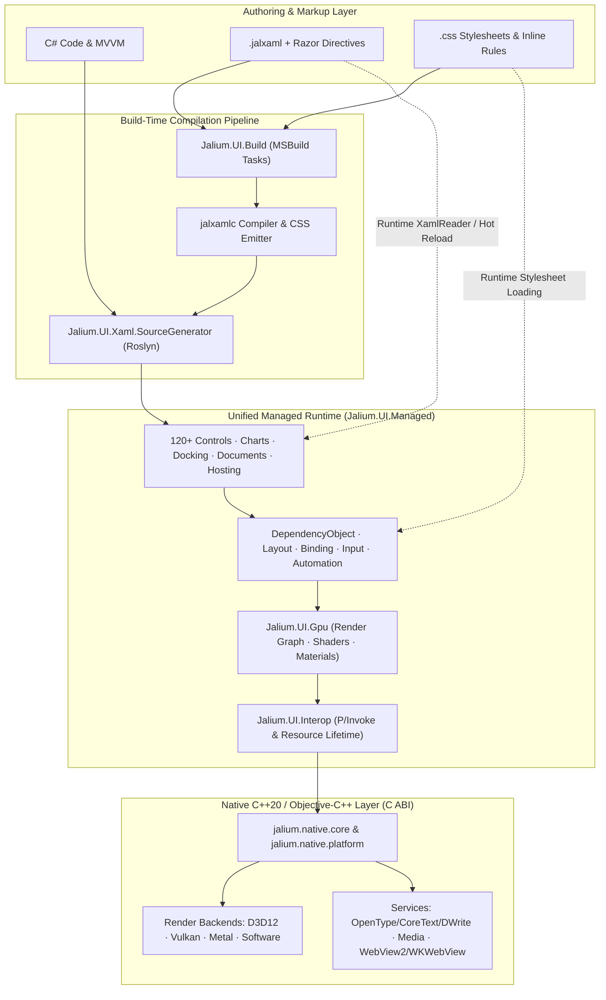

<div align="center">


# Jalium.UI

**A GPU-Accelerated Cross-Platform UI Framework for .NET 10**

Build native applications with **C#**, **JALXAML with Razor syntax**, and **CSS styling & layout** across **Windows**, **macOS**, **Linux**, and **Android**, with **iOS/iPadOS** and **tvOS** development hosts and a native **visionOS** build path.

[](https://www.nuget.org/packages/Jalium.UI)
[](https://github.com/VeryJokerJal/Jalium.UI/releases/latest)
[](https://dotnet.microsoft.com/)
[](https://github.com/VeryJokerJal/Jalium.UI/actions/workflows/linux.yml)
[](https://github.com/VeryJokerJal/Jalium.UI/actions/workflows/apple.yml)
[](https://github.com/VeryJokerJal/Jalium.UI/blob/master/LICENSE)
[](https://deepwiki.com/VeryJokerJal/Jalium.UI)

**English** · [简体中文](https://github.com/VeryJokerJal/Jalium.UI/blob/master/README.zh-CN.md) · [日本語](https://github.com/VeryJokerJal/Jalium.UI/blob/master/README.ja.md) · [한국어](https://github.com/VeryJokerJal/Jalium.UI/blob/master/README.ko.md)

[Overview](#overview) · [Platforms](#platforms-and-status) · [Architecture](#architecture) · [Capabilities](#capabilities) · [Quick Start](#quick-start) · [Build](#build-from-source) · [Testing](#testing-and-validation) · [Documentation](#documentation)

</div>

---

## Overview

**Jalium.UI** combines a WPF-inspired programming model with its own unified managed visual tree and hardware-accelerated native rendering backends. Applications can be authored in C#, declarative `.jalxaml`, or a hybrid of both, with a built-in CSS engine providing an additional styling and layout system.

<table>
  <tr>
    <td width="50%" valign="top">
      <h3>Familiar Application Model</h3>
      <p>Dependency properties (<code>DependencyObject</code>), routed events, compiled and runtime data binding, commands, resource dictionaries, styles, control/data templates, and first-class MVVM.</p>
    </td>
    <td width="50%" valign="top">
      <h3>Multi-Backend Native Rendering</h3>
      <p>Direct3D 12, Vulkan, Metal, and CPU software backends powered by Impeller and Vello path engines, featuring vector graphics, sub-pixel text, animation, liquid glass, backdrop blur, and custom HLSL shaders.</p>
    </td>
  </tr>
  <tr>
    <td width="50%" valign="top">
      <h3>Declarative JALXAML + Razor + CSS</h3>
      <p>Author markup in <code>.jalxaml</code> with inline Razor expressions, control flow (<code>@if</code>, <code>@for</code>, <code>@foreach</code>), viewport recycling (<code>@virtualize</code>), Roslyn source-generated code-behind, and build-time or runtime CSS.</p>
    </td>
    <td width="50%" valign="top">
      <h3>120+ Controls, Charts & Editors</h3>
      <p>Includes <code>DataGrid</code>, <code>TreeDataGrid</code>, <code>DockLayout</code>, <code>Ribbon</code>, <code>NavigationView</code>, 15+ chart and diagram types, <code>RichTextBox</code>, <code>EditControl</code>, <code>Markdown</code>, <code>DiffViewer</code>, <code>HexEditor</code>, <code>Terminal</code>, <code>InkCanvas</code>, and <code>WebView</code>.</p>
    </td>
  </tr>
  <tr>
    <td width="50%" valign="top">
      <h3>Standard .NET Generic Host</h3>
      <p><code>AppBuilder</code> implements <code>IHostApplicationBuilder</code> for seamless dependency injection, configuration, logging, options, metrics, and hosted background services.</p>
    </td>
    <td width="50%" valign="top">
      <h3>Diagnostics, Hot Reload & Accessibility</h3>
      <p>Opt-in in-app DevTools inspector, real-time debug HUD, named-pipe JALXAML hot reload, headless visual/semantic snapshot rendering, and automation peers bridged to Windows UIA, macOS AppKit AX, and Linux AT-SPI2.</p>
    </td>
  </tr>
</table>

---

## Platforms and status

> [!IMPORTANT]
> The current source version is **26.11.0**, defined in [`Directory.Build.props`](https://github.com/VeryJokerJal/Jalium.UI/blob/master/Directory.Build.props). Because the framework is under active development, keep all `Jalium.UI.*` package versions strictly aligned. Source support, package layouts, and validation coverage have distinct boundaries.

| Platform | Application entry | Native host and rendering | Scope |
| --- | --- | --- | --- |
| **Windows 10/11** | `Jalium.UI.Desktop` · `net10.0-windows` | Win32 · D3D12, software; optional Vulkan | `win-x64` is the primary native solution target; `win-arm64` asset layout also exists, with different qualification coverage |
| **macOS 15+** | `Jalium.UI.MacOS` · `net10.0-macos` · `osx-arm64`, `osx-x64` | AppKit · Metal, software · CoreText | Apple Silicon and Intel x64 application host and Gallery; use the pinned Apple toolchain and [macOS guide](https://github.com/VeryJokerJal/Jalium.UI/blob/master/docs/macos-development.md) |
| **Linux desktop** | `Jalium.UI.Linux` · `net10.0` | X11 / Wayland · Vulkan, software | glibc/musl x64/Arm64 layouts; consult the [verification matrix](https://github.com/VeryJokerJal/Jalium.UI/blob/master/docs/linux-parity-status.md) for RID and desktop coverage |
| **Android 7.0+ / API 24+** | `Jalium.UI.Android` · `net10.0-android` | Android activity · Vulkan, software | `arm64-v8a` and `x86_64` native payloads; uses the Android activity/lifecycle entry |
| **iOS / iPadOS 18+** | `Jalium.UI.iOS` · `net10.0-ios` | UIKit scenes · statically linked Metal | Development entry package and Arm64 device/simulator build paths; device and distribution acceptance remain separate |
| **tvOS 18+** | `Jalium.UI.tvOS` · `net10.0-tvos` | UIKit scenes, remote/focus integration · statically linked Metal | Development entry package and Arm64 device/simulator build paths; qualification is not equivalent to desktop support |
| **visionOS 2+ (native)** | Native C ABI / XCFramework slices; no managed entry package | UIKit-family host · Metal | Arm64 device/simulator presets and native validation only; no managed application TFM is defined here |

The table distinguishes application platforms from native-only development targets. The platform definitions are in [`src/packaging`](https://github.com/VeryJokerJal/Jalium.UI/tree/master/src/packaging) and [`CMakePresets.json`](https://github.com/VeryJokerJal/Jalium.UI/blob/master/src/native/CMakePresets.json); a declared deployment floor is not a record of testing on that OS version.

Jalium.UI follows many WPF concepts, but API and behavior compatibility must be checked for the application being ported. Platform-specific controls, codecs, window operations, and accessibility behavior depend on their native implementation.

### Runtime identifiers, architectures, and deployment

| Target | RID / native ABI | Deployment model |
| --- | --- | --- |
| **Windows x64 / Arm64** | `win-x64`, `win-arm64` | Managed application with matching native DLLs; Windows NativeAOT/static linking has its own build path. ARM64 assets are packed only when a completed payload is present |
| **macOS Apple Silicon / Intel** | `osx-arm64`, `osx-x64` | AppKit `.app` with target-specific dylibs and Metal shader resources; each SDK `RuntimeIdentifier` selects and validates its matching single-architecture native payload |
| **Linux glibc x64 / Arm64** | `linux-x64`, `linux-arm64` | glibc 2.31 / `GLIBCXX_3.4.28` release baseline; X11 or Wayland and system dependencies remain necessary |
| **Linux musl x64 / Arm64** | `linux-musl-x64`, `linux-musl-arm64` | Matching musl host/payload; glibc and musl assets are separate. Qualification varies by RID |
| **Android Arm64 / x64** | `android-arm64` → `arm64-v8a`; `android-x64` → `x86_64` | Activity/APK with ABI-specific `.so` files and `libc++_shared.so`; native package delivery requires both ABIs |
| **iOS / iPadOS** | `ios-arm64`, `iossimulator-arm64` | UIKit app with static `JaliumNative.xcframework`, bundled `.metallib` files, and the corresponding device/simulator slice |
| **tvOS** | `tvos-arm64`, `tvossimulator-arm64` | UIKit/remote-focus app with static XCFramework and Metal resources |
| **visionOS native validation** | `visionos-arm64`, `visionossimulator-arm64` | Repository-defined native slice identifiers; not NuGet application RIDs or a managed TFM |

Shared controls, binding, resources, MVVM, JALXAML, and the implemented CSS subset can be reused across platform projects. Each application still supplies the matching target framework, entry point, native payload, and OS permissions/lifecycle integration. Self-contained or single-file publishing does not remove native window-system, codec, or driver requirements. Windows/Linux NativeAOT, macOS app-bundle deployment, and embedded Apple static linking have separate validation scopes.

### Desktop integration matrix

These cells describe implemented paths; optional services and the qualification limits below still apply.

| Capability | Windows | macOS | Linux |
| --- | --- | --- | --- |
| **Graphics and text** | D3D12, optional Vulkan, software; Windows text services | Metal, software, CoreText; Retina scaling | Vulkan, software; self-hosted OpenType and Fontconfig |
| **Input and data exchange** | Keyboard/IME, pointer/touch/pen, Win32 clipboard and OLE drag-and-drop | AppKit responders/IME, gestures/tablet, NSPasteboard and native drag-and-drop | X11/XIM/XInput2 and Wayland text-input/touch/tablet protocols; multi-format clipboard and drag-and-drop |
| **File dialogs** | Native Windows/COM open/save/folder dialogs | `NSOpenPanel` / `NSSavePanel` | xdg-desktop-portal FileChooser; requires the session service and desktop backend |
| **Printing** | Native Windows print dialog and queue APIs | No adapter in the shared `PrintDialog` implementation | PDF submission through the Print portal; queue administration remains Windows-only |
| **Embedded browser** | WebView2; requires its runtime | WKWebView native adapter; integration qualification tracked separately | No in-tree native browser backend |
| **Accessibility** | Windows UIA peers/bridge | AppKit accessibility peers/bridge | AT-SPI2 over the accessibility bus |
| **System notifications** | WinRT toast adapter | No built-in `SystemNotificationManager` adapter | libnotify / desktop notification service |
| **Shell terminal** | ConPTY | POSIX PTY | POSIX PTY |

`NotifyIcon` currently has a concrete Linux StatusNotifierItem implementation; its Windows-shaped API does not establish a completed Windows or macOS tray backend. macOS Dock/taskbar integration is a separate API. `WindowsFormsHost` is Windows-only. Ordinary Jalium content dialogs, flyouts, and in-app toast UI remain distinct from native OS dialogs and notifications.

### Mobile and television integration matrix

| Capability | Android | iOS / iPadOS development | tvOS development |
| --- | --- | --- | --- |
| **Host and lifecycle** | `JaliumActivity`, SurfaceView/JNI, surface replacement and activity lifecycle | `JaliumIOSApplicationDelegate`, UIKit scenes, safe area/orientation and app lifecycle | `JaliumTVApplicationDelegate`, UIKit scenes and remote/focus events |
| **Input** | Touch/pen, hardware keys, InputConnection and soft keyboard bridge | Touch/Pencil sample forwarding, `UIKeyInput`, keyboard frame and safe-area events | Remote direction/select/menu/play-pause keys and focus navigation |
| **Clipboard** | Plain-text JNI path; generic multi-format get/set reports unsupported | UIKit pasteboard text/data paths | Clipboard entry points report unsupported |
| **Media** | Native image/video/camera paths, MediaCodec and supported GPU surfaces; device/API/permission dependent | Apple image/video/capture paths; device and permission dependent | Apple image/video playback; camera/microphone capture entry points report not implemented |
| **Embedded browser** | No in-tree browser backend | WKWebView native adapter | Browser entry points report not implemented |
| **System notifications** | Managed adapter exists; required notification helper exports are absent from the current Android native sources | No built-in system notification adapter | No built-in system notification adapter |

The shared automation-peer model is not a dedicated Android TalkBack or UIKit accessibility export; those mobile adapters are not provided by the current desktop bridges. Desktop file-picker, print-queue, tray, and freely positioned multi-window behavior should not be assumed on mobile hosts. iOS/tvOS entries need their own app bundle, lifecycle delegate, signing/provisioning, resources, and device acceptance.

### Runtime selection and current boundaries

- **Backend selection:** Desktop rendering can be selected with `JALIUM_RENDER_BACKEND=auto`, `d3d12`, `vulkan`, `metal`, or `software`, provided that backend exists for the target. `JALIUM_WINDOW_SYSTEM=auto|x11|wayland` is Linux-specific. Software rendering still requires a usable platform host/display.
- **Linux dependencies:** Linux Vulkan needs a compatible Vulkan loader/driver; software presentation uses X11 or Wayland. GStreamer and codec plugins are loaded for the media features that need them; portal, D-Bus, accessibility, notification, and CJK-font dependencies are capability-specific.
- **Wayland constraints:** Wayland supports compositor-provided scale/viewport protocols when available. Global cursor/window coordinates, always-on-top, whole-window opacity, and forced activation are constrained by the compositor; X11 and Wayland do not expose identical window capabilities.
- **Architecture scope:** macOS presets cover `osx-arm64` and `osx-x64`. Intel Apple simulators, Windows x86, Android Arm32, Linux Arm32, and browser/WebAssembly are outside the listed application/package targets. Other Unix code branches do not establish a release target without a matching platform host and RID mapping.
- **Hardware & OS qualification:** Camera/microphone, GPU video import, IME, pen/touch, assistive technology, and store/distribution acceptance depend on the OS version, permissions, device, and driver. The [Linux matrix](https://github.com/VeryJokerJal/Jalium.UI/blob/master/docs/linux-parity-status.md) and [macOS ledger](https://github.com/VeryJokerJal/Jalium.UI/blob/master/docs/macos-window-behavior.md) retain the revision-specific evidence and outstanding work.

---

## Architecture

### Runtime and build flow



The implementation sources remain organized by subsystem. Most core, media, input, interop, and control sources are compiled together into **`Jalium.UI.Managed`**. Compatibility assemblies (`Jalium.UI.Core`, `.Media`, `.Input`, `.Controls`) forward those types, preserving the public package/namespace structure without compiling separate copies of the implementation.

### Managed packages and tools

| Component | Responsibility |
| --- | --- |
| `Jalium.UI.Managed` | Unified implementation: dependency properties, layout, binding, input, drawing, controls, hosting, and automation |
| `Jalium.UI.Core`, `.Media`, `.Input`, `.Controls` | Compatibility facades using type forwarding to the unified implementation |
| `Jalium.UI.Interop` | Interop API facade plus native runtime assets and deployment integration |
| `Jalium.UI.Gpu` | GPU resources, render graph, materials, shaders, and rendering abstractions |
| `Jalium.UI.Xaml` | JALXAML loading, markup extensions, Razor runtime support, resources, and hot reload |
| `Jalium.UI.Build` | Packaged MSBuild tasks/targets for JALXAML, CSS, shader, native, and AOT build integration |
| `Jalium.UI.Xaml.SourceGenerator` | Roslyn analyzer/source generator for generated views, bindings, and markup lowering |
| `Jalium.UI` | Shared dependency metapackage; applications select a platform entry package |
| `Jalium.UI.Compiler` | Portable `jalxamlc` executable used by build tooling; not an independently installable NuGet package |
| `Jalium.UI.Css.Tooling` | Internal Node-based Sass/Less/Prettier helpers; not a public NuGet package or a requirement for ordinary CSS authoring |

### Native modules

| Module | Responsibility |
| --- | --- |
| `jalium.native.core` | C ABI, rendering contexts, backend registration, and shared runtime contracts |
| `jalium.native.platform` | Native windows, events, input, clipboard, and platform integration |
| `jalium.native.d3d12` / `.vulkan` / `.metal` / `.software` | GPU and CPU rendering backends |
| `jalium.native.text` | Self-hosted OpenType shaping/rasterization for Linux/Android, with Fontconfig discovery on Linux |
| `jalium.native.media.core` | Shared media ABI and audio implementation |
| `jalium.native.media.windows` | Media Foundation and WIC integration |
| `jalium.native.media.linux` | Dynamically loaded GStreamer integration |
| `jalium.native.media.android` | Android native media, image, and camera integration |
| `jalium.native.media.apple` | AVFoundation, VideoToolbox, ImageIO, and Apple media services |
| `jalium.native.browser` / `.browser.apple` | Windows WebView2 / Apple WebKit integration, subject to platform availability |
| `jalium.native.aot` | Static native aggregator for NativeAOT and Apple embedded-platform linking |

GPU backend selection (D3D12/Vulkan/Metal) is separate from path-rendering engine selection (`RenderingEngine.Impeller` / `RenderingEngine.Vello`). Available engines and effect coverage depend on the backend.

---

## Capabilities

| Category | Components and Features |
| --- | --- |
| **Layout & Containers** | `Grid`, `StackPanel`, `Canvas`, `DockPanel`, `WrapPanel`, `UniformGrid`, `FlexPanel`, `Viewbox`, `ScrollViewer`, `Expander`, `GroupBox`, `Splitter`, `DockLayout`, virtualizing panels, and CSS block/flex/grid layout |
| **Basic & Input Controls** | `Button`, `RepeatButton`, `ToggleButton`, `SplitButton`, `HyperlinkButton`, `TextBox`, `PasswordBox`, `NumberBox`, `AutoCompleteBox`, `ComboBox`, `CheckBox`, `RadioButton`, `ToggleSwitch`, `Slider`, `RangeSlider`, `Calendar`, `DatePicker`, `TimePicker`, `ColorPicker`, `Thumb` |
| **Data & Navigation** | `DataGrid`, `TreeDataGrid`, `ListView`, `ListBox`, `TreeView`, `TreeSelector`, `PropertyGrid`, `JsonTreeViewer`, `NavigationView`, `Frame`, `TabControl`, `Ribbon`, `MenuBar`, `Menu`, `ContextMenu`, `MenuFlyout`, `CommandBar`, `CommandBarFlyout`, `ToolBar`, `SwipeControl`, `StatusBar`, `InfoBar` |
| **Documents & Editors** | `RichTextBox`, `EditControl` (syntax-highlighted code editor), `FlowDocument` viewers (`FlowDocumentReader`, `FlowDocumentScrollViewer`, `FlowDocumentPageViewer`), `DocumentViewer`, `Markdown`, `DiffViewer`, `HexEditor`, and `Terminal` |
| **Charts & Visualization** | `LineChart`, `BarChart`, `PieChart`, `ScatterPlot`, `CandlestickChart`, `Heatmap`, `Sparkline`, `GaugeChart`, `TreeMap`, `GanttChart`, `NetworkGraph`, `SankeyDiagram`, `Flowchart`, `MapView`, `MiniMap`, and `GeographicHeatmap` |
| **Media & System Integration** | `Image` (animated GIF/APNG/WebP), `MediaElement`, `CameraView`, `WebView`, `InkCanvas`, `QRCode`, `IconElement`, `PathIcon`, `ContentDialog`, `Popup`, `ToolTip`, `ToastNotification`, `SystemNotification`, `NotifyIcon`, `TitleBar`, printing, and Windows-only `WindowsFormsHost` |
| **Graphics & GPU Effects** | Vector paths, geometries, gradients, transforms, analytical and stencil clipping, drop/inner shadows, Gaussian/box/frosted blur, acrylic/mica, liquid glass with refraction and dispersion, content transitions, and custom HLSL pixel shaders |

### Text, input, and accessibility

- **Unicode-accurate text:** Grapheme-cluster aware (UAX#29) caret movement, selection, and deletion; IME composition; rich document editing; and encoding-aware text file/terminal handling.
- **Native text engines:** Platform text paths include Windows DirectWrite/text services, CoreText on Apple platforms, and the self-hosted OpenType engine on Linux/Android. Font fallback, color glyphs, and antialiasing vary by platform and backend.
- **Unified input routing:** Mouse, keyboard, multi-touch, stylus/pen, gesture recognition, manipulation with physical inertia, and smooth/coarse scrolling are routed through the managed input system. Hardware acceptance is tracked independently of synthetic event tests.
- **Accessibility bridges:** Automation peers connect to Windows UIA, Linux AT-SPI2, and macOS AppKit accessibility. Bridge and peer coverage does not by itself establish screen-reader acceptance.

### Media and effects

The audio pipeline includes native playback, WAV/FLAC/MP3/Vorbis decoding, platform codecs, and WSOLA pitch-preserving time stretching. Video uses native decoders and `NativeVideoSurface` for CPU frames or supported external GPU resources. GPU import/zero-copy depends on the backend, resource format, decoder, and driver; see the [Linux media boundaries](https://github.com/VeryJokerJal/Jalium.UI/blob/master/docs/linux.md#media).

Custom shaders use HLSL where supported. On macOS, use `PixelShader.SourceHlsl`; the Metal toolchain translates through DXC and SPIRV-Cross. DirectX bytecode remains Windows-specific. See [Metal effects and validation](https://github.com/VeryJokerJal/Jalium.UI/blob/master/docs/macos-development.md#metal-shader-effects).

### Hosting and diagnostics

`AppBuilder` implements `IHostApplicationBuilder`. Configure services, logging, options, and view/view-model registration before `Build()`. The resulting `JaliumApp` owns the host and application lifecycle; `Run()` starts hosted services, enters the UI loop, and shuts the host down on exit. AppKit, Android, and UIKit use their platform lifecycle hosts.

Extensions in `Jalium.UI.Hosting` include `AddView<TView, TViewModel>`, `ConfigureJalium()`, `UseJaliumMetrics()`, `UseDevTools()`, and `UseDebugHud()`. DevTools and the HUD are opt-in and provide tree/property inspection, layout/binding/event diagnostics, rendering telemetry, and visual overlays. The hot-reload runtime accepts JALXAML updates over a named pipe; a standalone launcher/watcher lives in `tools/Jalium.UI.HotReload.Watcher`.

Generated markup and explicitly registered views help trimming/AOT. Runtime parsing and reflection-based discovery still require application-specific trimming validation.

---

## Installation

Choose the entry package for the application platform:

```bash
dotnet add package Jalium.UI.Desktop --version 26.11.0   # Windows
dotnet add package Jalium.UI.Linux --version 26.11.0     # Linux
dotnet add package Jalium.UI.MacOS --version 26.11.0     # macOS
dotnet add package Jalium.UI.Android --version 26.11.0   # Android
```

Run only the command for your target. Match the project's target framework to the platform table and install its .NET workload where required. Shared libraries can reference `Jalium.UI`; the final application supplies the native platform entry. Use the source projects for iOS/tvOS development and their static native payloads.

---

## Quick start

### 1. A C# desktop application

On Windows, create an empty directory containing `HelloJalium.csproj`:

```xml
<Project Sdk="Microsoft.NET.Sdk">
  <PropertyGroup>
    <OutputType>WinExe</OutputType>
    <TargetFramework>net10.0-windows</TargetFramework>
    <ImplicitUsings>enable</ImplicitUsings>
    <Nullable>enable</Nullable>
  </PropertyGroup>
  <ItemGroup>
    <PackageReference Include="Jalium.UI.Desktop" Version="26.11.0" />
  </ItemGroup>
</Project>
```

Add `Program.cs`. The STA entry point is needed for Windows desktop services such as COM-backed clipboard and dialogs:

```csharp
using Jalium.UI;
using Jalium.UI.Controls;

internal static class Program
{
    [STAThread]
    private static int Main(string[] args)
    {
        var builder = AppBuilder.CreateBuilder(args);
        builder.ConfigureApplication(app =>
        {
            var greeting = new TextBlock { Text = "Hello, Jalium.UI", FontSize = 28 };
            var button = new Button
            {
                Content = "Click me",
                Margin = new Thickness(0, 16, 0, 0)
            };
            button.Click += (_, _) => greeting.Text = "Welcome to Jalium.UI!";

            app.MainWindow = new Window
            {
                Title = "Hello Jalium.UI",
                Width = 800,
                Height = 500,
                Content = new StackPanel
                {
                    Margin = new Thickness(24),
                    Children = { greeting, button }
                }
            };
        });

        using var host = builder.Build();
        return host.Run();
    }
}
```

Run from that directory:

```bash
dotnet run -c Release
```

For Linux, use `net10.0` and `Jalium.UI.Linux` with the same application code, and install the native dependencies listed in the [Linux guide](https://github.com/VeryJokerJal/Jalium.UI/blob/master/docs/linux.md#runtime-dependencies). macOS and Android need their AppKit/activity entry points; use the platform samples/guides below.

### 2. Declarative JALXAML

```xml
<Window xmlns="http://schemas.microsoft.com/winfx/2006/xaml/presentation"
        Title="JALXAML Window" Width="800" Height="500">
    <StackPanel Margin="24">
        <TextBlock Text="Hello from JALXAML" FontSize="28" />
        <Button Content="Start" Margin="0,16,0,0" />
    </StackPanel>
</Window>
```

For a generated view, add `x:Class`, a matching partial code-behind class, and call `InitializeComponent()` from its constructor. `Jalium.UI.Build` discovers `.jalxaml` files and supplies the source generator with the transformed markup. Runtime loading is also available through `Jalium.UI.Markup.XamlReader.Parse(...)`; assign the parsed `Window` inside the `ConfigureApplication` callback above.

### 3. Razor syntax and virtualized lists

JALXAML adds `@Path`, `@(expr)`, `@{ ... }`, `@if`/`@else`, `@section`/`@RenderSection`, and loop directives alongside `{Binding ...}`. `$.Path` reads the element's own property; `#.Path` restricts resolution to `DataContext`.

For a data-bound list, expose `Rows` on the data context and use:

```xml
<ScrollViewer Height="360">
    @virtualize(var row in Rows)
    {
        <Border Padding="8"><TextBlock Text="@row.Name" /></Border>
    }
</ScrollViewer>
```

`@virtualize` recycles viewport containers and observes collection changes. Its body must have one root element and a bounded scrolling axis. `@foreach` and `@for` expand once at load and are suitable for small static lists. Observable bindings update when their source notifies; ordinary CLR values without notifications are evaluated once. See the [Razor reference](https://github.com/VeryJokerJal/Jalium.UI/blob/master/docs/razor-syntax.md) for compile-time lowering and runtime boundaries.

### 4. CSS styling

```xml
<Border xmlns="http://schemas.microsoft.com/winfx/2006/xaml/presentation"
        Css.StyleSheetSource="Styles/App.css" Css.Class="card">
    <TextBlock Text="Styled with CSS" Css.Class="heading" />
</Border>
```

```css
/* Styles/App.css */
.card {
    background-color: #eef6ff;
    border-radius: 12px;
    padding: 24px;
}
.heading {
    color: #175cd3;
    font-size: 28px;
    font-weight: 600;
}
```

`Css.StyleSheetSource` resolves ordinary paths from the declaring JALXAML assembly's resource root, rather than the markup file's directory. The default build targets compile `.css` files and inline CSS into generated registrations. Runtime stylesheets and dynamic stylesheet binding are also available.

CSS includes selectors, cascade/layers, custom properties, media/container queries, flex/grid, positioning, typography, generated content, images, masks, and effects within the implemented subset. It operates on Jalium's visual/document model and template boundaries. Query `Jalium.UI.Styling.CssAuthoring` or `Css.Supports()` for implemented syntax; parser acceptance alone does not establish rendering parity on every backend. See [CSS authoring and limitations](https://github.com/VeryJokerJal/Jalium.UI/blob/master/docs/css-authoring.md).

---

## Build from source

> [!NOTE]
> Run these commands from the repository root. Managed compilation and native payload generation are separate steps; a successful managed build alone does not produce a runnable native application.

### Prerequisites

| Scope | Requirements |
| --- | --- |
| **Managed** | .NET 10 SDK compatible with [`global.json`](https://github.com/VeryJokerJal/Jalium.UI/blob/master/global.json): minimum `10.0.300`, `latestFeature` roll-forward, prereleases allowed |
| **Native** | CMake **3.28+** and a C++20 toolchain; Apple sources also use Objective-C++ |
| **Windows native solution** | Visual Studio C++ workload, Windows SDK, **v145** toolset, and Vulkan SDK for the checked-in full native solution |
| **Linux** | Ninja, GCC/Clang, Vulkan headers/loader, X11/Wayland development libraries, and Fontconfig; see the [dependency list](https://github.com/VeryJokerJal/Jalium.UI/blob/master/docs/linux.md#build-validate-and-package) |
| **macOS / Apple** | Apple Silicon or Intel Mac (macOS 15+ target), Xcode/Metal tools, Ninja, Python 3.9+, and the platform .NET workload; exact versions are in [`eng/apple/toolchain.lock.json`](https://github.com/VeryJokerJal/Jalium.UI/blob/master/eng/apple/toolchain.lock.json) |
| **Android** | .NET Android workload, Android SDK/JDK, and NDK **27.2.12479018** for the canonical helper |

The Apple lock selects SDK `10.0.302`, workload set `10.0.302.1`, and Xcode `26.6`; these are separate from the general SDK minimum. Follow the [Apple setup guide](https://github.com/VeryJokerJal/Jalium.UI/blob/master/docs/macos-development.md#prerequisites) when selecting toolchains.

### Shared managed libraries

```bash
dotnet build src/packaging/Jalium.UI/Jalium.UI.csproj -c Release
```

For concurrent or cross-OS builds, pass a distinct absolute `-p:JaliumBuildRoot=...` to isolate each invocation's `obj`/`bin` tree. Keep the same root for the matching restore/build/test steps. The solution intentionally excludes some samples, tools, and Apple entry points from default builds; build the desired project explicitly.

### Windows

In a Visual Studio Developer Command Prompt:

```powershell
msbuild src/native/Jalium.Native.sln /m /p:Configuration=Release /p:Platform=x64
dotnet run --project samples/Jalium.UI.DesktopDemo/Jalium.UI.DesktopDemo.csproj -c Release
```

### Linux

On a matching architecture and glibc/musl host:

```bash
JALIUM_NATIVE_BUILD_TESTS=1 bash eng/linux/build-native.sh linux-x64 Release
dotnet run --project samples/Jalium.UI.LinuxDemo/Jalium.UI.LinuxDemo.csproj -c Release
```

The helper also accepts `linux-arm64`, `linux-musl-x64`, and `linux-musl-arm64`; it validates the host instead of silently cross-compiling. Cross-build and glibc-baseline helpers live in `eng/linux`. Run shell scripts with LF line endings.

### macOS

```bash
bash eng/apple/build-native.sh macos Debug --development
```

Native scripts follow the current CPU by default; set `JALIUM_APPLE_ARCHITECTURE=arm64|x86_64` to target a specific macOS architecture (cross-architecture builds require `--build-only`). For the full Gallery, place the [Gallery repository](https://github.com/VeryJokerJal/Jalium-UI-Gallery) beside this checkout as `Jalium.UI.Gallery`, or set `JALIUM_GALLERY_ROOT`, then run:

```bash
bash eng/apple/run-gallery.sh Debug
```

The Gallery helper builds the native payload, runs its native checks, builds the `.app`, and opens it. Add `--build-only` to leave it closed. It prepares the pinned shader compiler on first use. AppKit principal-class setup, output paths, and toolchain overrides are documented in the [macOS guide](https://github.com/VeryJokerJal/Jalium.UI/blob/master/docs/macos-development.md).

### Android

The current canonical helper uses the **Windows NDK host tools** and a Bash environment such as Git Bash:

```bash
bash src/native/build-android.sh all
```

`all` builds and stamps both package ABIs; a single-ABI build is for development and invalidates the complete package stamp. `JALIUM_ANDROID_NDK_VERSION` and `ANDROID_NDK_ROOT` deliberately override the NDK selection. See `samples/Jalium.UI.AndroidDemo` for the activity entry.

### iOS, iPadOS, and tvOS

On a Mac with the pinned Xcode/.NET toolchain, build all four required static slices before assembling the XCFramework. The entry-library builds below do not create a complete runnable app:

```bash
dotnet workload install ios tvos --version 10.0.302.1

bash eng/apple/build-native.sh ios Release
bash eng/apple/build-native.sh iossimulator Release
bash eng/apple/build-native.sh tvos Release
bash eng/apple/build-native.sh tvossimulator Release
bash eng/apple/package-xcframework.sh Release

dotnet build src/packaging/Jalium.UI.iOS/Jalium.UI.iOS.csproj -c Release -r ios-arm64
dotnet build src/packaging/Jalium.UI.tvOS/Jalium.UI.tvOS.csproj -c Release -r tvos-arm64
```

For simulator entry-library builds, select `iossimulator-arm64` or `tvossimulator-arm64` with the corresponding project. An application subclasses `JaliumIOSApplicationDelegate` or `JaliumTVApplicationDelegate`, implements `CreateHostedApp()`, and uses the platform scene lifecycle. Keep `.metallib`/manifest resources alongside the matching XCFramework slice. Apps authoring JALXAML also need the build/source-generator integration described above. Device app bundles and signing/provisioning are separate application build steps.

### visionOS native slices

After the required iOS/tvOS slices exist, optionally add the visionOS slices and regenerate the XCFramework:

```bash
bash eng/apple/build-native.sh visionos Release
bash eng/apple/build-native.sh visionsimulator Release
bash eng/apple/package-xcframework.sh Release
```

The `visionsimulator` script argument selects the `apple-visionossimulator-arm64` preset. This prepares native Metal/platform/media code for native validation; there is no `Jalium.UI.visionOS` project or managed application build command in this repository.

### Packaging and NativeAOT

```bash
dotnet pack src/packaging/Jalium.UI/Jalium.UI.csproj -c Release -o artifacts/nuget
```

This packs the shared metapackage, not an entire platform distribution. Platform packaging requires matching native payloads, export checks, and completion/provenance stamps. Native outputs are isolated under `src/native/bin/native/<rid>/<Configuration>`; Apple static slices/XCFrameworks use `src/native/artifacts/apple`. Use matching configurations and rebuild payloads after ABI changes.

Windows/Linux NativeAOT paths and Apple static linking are implemented separately. See `samples/Jalium.UI.AotWindowDemo`, `eng/linux/test-native-aot-static.sh`, `eng/apple/package-xcframework.sh`, and the [release workflows](https://github.com/VeryJokerJal/Jalium.UI/tree/master/.github/workflows) for the corresponding build and validation steps.

---

## Testing and validation

Run suites on the host they target, after preparing any required native payload:

```bash
# Portable generated-template contracts
dotnet test tests/Jalium.UI.Template.Tests/Jalium.UI.Template.Tests.csproj -c Release

# Windows managed suite
dotnet test tests/Jalium.UI.Tests/Jalium.UI.Tests.csproj -c Release

# Linux portable/managed suite
dotnet test tests/Jalium.UI.Linux.Tests/Jalium.UI.Linux.Tests.csproj -c Release

# macOS managed contracts; requires the matching Debug native payload
dotnet test tests/Jalium.UI.MacOS.Tests/Jalium.UI.MacOS.Tests.csproj -c Debug
```

Native CTest targets cover renderer readback, text, effects, media, window/input lifetimes, and platform integration. Linux integration checks additionally need the appropriate compositor/display, D-Bus services, and test dependencies. Apple window tests use a separate `Jalium.UI.MacOS.HostSmoke` AppKit host; video interop tests require their CMake-built shim. NuGet consumer projects use a prepared package feed and remain outside the default solution restore.

The [Linux](https://github.com/VeryJokerJal/Jalium.UI/actions/workflows/linux.yml), [Apple](https://github.com/VeryJokerJal/Jalium.UI/actions/workflows/apple.yml), [D3D12 ink](https://github.com/VeryJokerJal/Jalium.UI/actions/workflows/d3d12-ink.yml), and Windows contract workflows define their own gates. Tests present in the tree or a successful focused suite do not establish a clean full regression. Physical GPUs/devices, real IME use, screen readers, and platform distribution must be accepted separately; consult the linked platform ledgers for outstanding items and the revision associated with each result.

---

## Samples and Gallery

| Location | Purpose |
| --- | --- |
| [Standalone Gallery](https://github.com/VeryJokerJal/Jalium-UI-Gallery) | Full 128-page control and effect showcase with Windows desktop, macOS, Linux, Android, and headless CLI entries |
| `samples/Jalium.UI.DesktopDemo` | C# Windows application and native integration |
| `samples/Jalium.UI.HostingDemo` | DI, MVVM, logging, configuration, options, metrics, and hosted services |
| `samples/Jalium.UI.LinuxDemo` | Linux windows, clipboard, dialogs, input, and backend selection |
| `samples/Jalium.UI.AndroidDemo` | Android activity and native library deployment |
| `samples/Jalium.UI.AotWindowDemo` | Windows NativeAOT application |
| `samples/Jalium.UI.BorderlessDemo`, `.TransparentBackdropDemo`, `.MillionScroll` | Window chrome, transparent backdrops, and virtualized scrolling experiments |
| `samples/Jalium.UI.Gallery` | Small in-tree Windows sample; the full Gallery is maintained in the separate repository above |

Gallery downloads are linked from [GitHub Releases](https://github.com/VeryJokerJal/Jalium.UI/releases). Check each release's platform requirements, signing notes, and verification scope.

---

## Repository layout

```text
src/managed/       Runtime sources, compatibility facades, XAML/GPU/build tooling
src/native/        C/C++/Objective-C++ modules, shaders, presets, vendored sources
src/packaging/     Shared and platform entry packages (Windows, Linux, macOS, Android, iOS, tvOS)
samples/           In-tree applications and focused demonstrations
tests/             Managed suites, native integration hosts, NuGet consumers
eng/apple/         Apple toolchain, shaders, packaging, and acceptance helpers
eng/linux/         Linux builds, ABI baselines, integration and package checks
eng/msbuild/       Native payload freshness/provenance guards
eng/release/       Release packaging and provenance tooling
tools/             Hot-reload watcher, API verifier, and source-data generators
docs/              Syntax, rendering, platform behavior, and validation guides
```

---

## Documentation

| Guide | Contents |
| --- | --- |
| [CSS authoring](https://github.com/VeryJokerJal/Jalium.UI/blob/master/docs/css-authoring.md) | Stylesheet resources, metadata, implemented layout/text/graphics behavior, and limitations |
| [Razor syntax](https://github.com/VeryJokerJal/Jalium.UI/blob/master/docs/razor-syntax.md) | Expressions, directives, virtualization, and lowering rules |
| [Drawing API](https://github.com/VeryJokerJal/Jalium.UI/blob/master/docs/drawing-api.md) | Drawing contexts, rendering, and GPU effects |
| [macOS development](https://github.com/VeryJokerJal/Jalium.UI/blob/master/docs/macos-development.md) | Toolchain setup, AppKit host, Gallery, Metal effects, and tests |
| [macOS window behavior](https://github.com/VeryJokerJal/Jalium.UI/blob/master/docs/macos-window-behavior.md) | Window/input/accessibility implementation and acceptance ledger |
| [macOS path rendering](https://github.com/VeryJokerJal/Jalium.UI/blob/master/docs/macos-path-rendering.md) | Path rendering architecture and validation |
| [Linux desktop](https://github.com/VeryJokerJal/Jalium.UI/blob/master/docs/linux.md) | Runtime/build dependencies, window systems, media, packaging, and platform limits |
| [Linux verification matrix](https://github.com/VeryJokerJal/Jalium.UI/blob/master/docs/linux-parity-status.md) | RID/feature evidence and remaining qualification work |
| [Linux window behavior](https://github.com/VeryJokerJal/Jalium.UI/blob/master/docs/linux-window-behavior.md) | Current window/input behavior and regression evidence |
| [Markdown syntax](https://github.com/VeryJokerJal/Jalium.UI/blob/master/docs/markdown-syntax.md) / [styling](https://github.com/VeryJokerJal/Jalium.UI/blob/master/docs/markdown-styling.md) | Markdown control content and appearance |
| [Manual build configuration](https://github.com/VeryJokerJal/Jalium.UI/blob/master/docs/manual-build-configuration.md) | Additional build settings and troubleshooting; prefer canonical platform helpers for ordinary builds |
| [Gallery startup performance](https://github.com/VeryJokerJal/Jalium.UI/blob/master/docs/gallery-startup-performance.md) | Tracing, baselines, and readiness measurements |
| [API parity verifier](https://github.com/VeryJokerJal/Jalium.UI/blob/master/tools/Jalium.UI.ApiParity/README.md) | Supported verifier self-test and archived-input requirements; not a current WPF-parity certification |

---

## Contributing and community

Issues and pull requests are welcome. Include the affected platform/backend, a small reproduction, the intended behavior, and validation steps. Rendering and input changes should include evidence for the relevant native path and clearly identify untested devices or interactions.

Community QQ group: **1079778999**.

## License

Jalium.UI is licensed under [MIT](https://github.com/VeryJokerJal/Jalium.UI/blob/master/LICENSE). Bundled dependencies retain their own terms; see the [third-party inventory](https://github.com/VeryJokerJal/Jalium.UI/blob/master/src/native/thirdparty/LICENSES.md) and licenses shipped with the relevant native payload.
