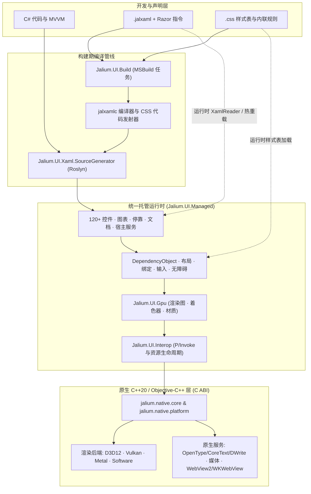

<div align="center">


# Jalium.UI

**面向 .NET 10 的 GPU 加速跨平台 UI 框架**

使用 **C#**、支持 **Razor 语法的 JALXAML** 与 **CSS 样式布局**，提供 **Windows**、**macOS**、**Linux**、**Android** 原生渲染，以及 **iOS/iPadOS**、**tvOS** 开发宿主和 **visionOS** 原生构建路径。

[](https://www.nuget.org/packages/Jalium.UI)
[](https://github.com/VeryJokerJal/Jalium.UI/releases/latest)
[](https://dotnet.microsoft.com/)
[](https://github.com/VeryJokerJal/Jalium.UI/actions/workflows/linux.yml)
[](https://github.com/VeryJokerJal/Jalium.UI/actions/workflows/apple.yml)
[](https://github.com/VeryJokerJal/Jalium.UI/blob/master/LICENSE)
[](https://deepwiki.com/VeryJokerJal/Jalium.UI)

[English](https://github.com/VeryJokerJal/Jalium.UI/blob/master/README.md) · **简体中文** · [日本語](https://github.com/VeryJokerJal/Jalium.UI/blob/master/README.ja.md) · [한국어](https://github.com/VeryJokerJal/Jalium.UI/blob/master/README.ko.md)

[概览](#概览) · [平台状态](#平台与项目状态) · [架构](#架构) · [能力概览](#能力概览) · [快速上手](#快速上手) · [构建](#从源码构建) · [测试](#测试与验证) · [文档](#文档)

</div>

---

## 概览

**Jalium.UI** 采用接近 WPF 的编程模型，构建在自研的统一托管可视树与原生 GPU 渲染后端之上。应用可以使用 C#、声明式 `.jalxaml`，或混合两种方式编写；内置 CSS 引擎提供额外的现代样式与布局能力。

<table>
  <tr>
    <td width="50%" valign="top">
      <h3>熟悉的应用模型</h3>
      <p>依赖属性（<code>DependencyObject</code>）、路由事件、编译期与运行时数据绑定、命令、资源字典、样式、控件/数据模板与一等公民的 MVVM 支持。</p>
    </td>
    <td width="50%" valign="top">
      <h3>多后端原生渲染</h3>
      <p>Direct3D 12、Vulkan、Metal 和 CPU 软件后端，结合 Impeller 与 Vello 路径引擎，覆盖矢量图形、亚像素文本、动画、液态玻璃、背景模糊与自定义 HLSL 着色器。</p>
    </td>
  </tr>
  <tr>
    <td width="50%" valign="top">
      <h3>声明式 JALXAML + Razor + CSS</h3>
      <p>在 <code>.jalxaml</code> 中直接使用 Razor 表达式、控制流（<code>@if</code>、<code>@for</code>、<code>@foreach</code>）、视口容器回收（<code>@virtualize</code>）、Roslyn 源生成代码隐藏，以及构建期或运行时 CSS。</p>
    </td>
    <td width="50%" valign="top">
      <h3>120+ 控件、图表与编辑器</h3>
      <p>涵盖 <code>DataGrid</code>、<code>TreeDataGrid</code>、<code>DockLayout</code>、<code>Ribbon</code>、<code>NavigationView</code>、15+ 种图表与拓扑图、<code>RichTextBox</code>、<code>EditControl</code>、<code>Markdown</code>、<code>DiffViewer</code>、<code>HexEditor</code>、<code>Terminal</code>、<code>InkCanvas</code> 与 <code>WebView</code>。</p>
    </td>
  </tr>
  <tr>
    <td width="50%" valign="top">
      <h3>标准 .NET 通用宿主</h3>
      <p><code>AppBuilder</code> 实现 <code>IHostApplicationBuilder</code>，原生接入依赖注入（DI）、配置、日志、Options、指标与后台托管服务。</p>
    </td>
    <td width="50%" valign="top">
      <h3>诊断、热重载与无障碍</h3>
      <p>按需启用的应用内 DevTools 检查器、实时调试 HUD、命名管道 JALXAML 热重载、无头（Headless）视觉/语义快照渲染，以及对接 Windows UIA、macOS AppKit AX 与 Linux AT-SPI2 的自动化 Peer。</p>
    </td>
  </tr>
</table>

---

## 平台与项目状态

> [!IMPORTANT]
> 当前源码版本为 **26.11.0**，以 [`Directory.Build.props`](https://github.com/VeryJokerJal/Jalium.UI/blob/master/Directory.Build.props) 为准。项目仍在持续开发，请保持所有 `Jalium.UI.*` 包版本严格一致。源码实现、包的 RID 布局和实际验证范围分别如下。

| 平台 | 应用入口 | 原生宿主与渲染 | 范围 |
| --- | --- | --- | --- |
| **Windows 10/11** | `Jalium.UI.Desktop` · `net10.0-windows` | Win32 · D3D12、软件；可选 Vulkan | 原生解决方案主要面向 `win-x64`；另有 `win-arm64` 资源布局，两者的验证覆盖不同 |
| **macOS 15+** | `Jalium.UI.MacOS` · `net10.0-macos` · `osx-arm64`、`osx-x64` | AppKit · Metal、软件 · CoreText | Apple Silicon 与 Intel x64 应用宿主及 Gallery；使用锁定的 Apple 工具链，参见 [macOS 指南](https://github.com/VeryJokerJal/Jalium.UI/blob/master/docs/macos-development.md) |
| **Linux 桌面** | `Jalium.UI.Linux` · `net10.0` | X11 / Wayland · Vulkan、软件 | glibc/musl 的 x64/Arm64 布局；各 RID 和桌面环境的实际覆盖见[验证矩阵](https://github.com/VeryJokerJal/Jalium.UI/blob/master/docs/linux-parity-status.md) |
| **Android 7.0+ / API 24+** | `Jalium.UI.Android` · `net10.0-android` | Android Activity · Vulkan、软件 | `arm64-v8a`、`x86_64` 原生载荷；通过 Activity 与系统生命周期启动 |
| **iOS / iPadOS 18+** | `Jalium.UI.iOS` · `net10.0-ios` | UIKit Scene · 静态链接 Metal | 开发中的入口包及 Arm64 真机/模拟器构建路径；设备与分发验收需单独完成 |
| **tvOS 18+** | `Jalium.UI.tvOS` · `net10.0-tvos` | UIKit Scene、遥控器/焦点集成 · 静态链接 Metal | 开发中的入口包及 Arm64 真机/模拟器构建路径；验证程度不等同桌面平台 |
| **visionOS 2+（原生）** | 原生 C ABI / XCFramework 切片；没有托管入口包 | UIKit 系列宿主 · Metal | Arm64 真机/模拟器预设与原生验证路径；本仓库未定义托管应用 TFM |

表中分别列出应用平台与仅原生层的开发目标。平台定义以 [`src/packaging`](https://github.com/VeryJokerJal/Jalium.UI/tree/master/src/packaging) 和 [`CMakePresets.json`](https://github.com/VeryJokerJal/Jalium.UI/blob/master/src/native/CMakePresets.json) 为准；声明的系统最低版本不等于已在该版本系统上完成验收。

Jalium.UI 的许多概念接近 WPF；迁移应用时仍需核对所用 API 与行为。平台专属控件、编解码器、窗口操作和无障碍行为取决于对应的原生实现。

### 运行时标识、CPU 架构与部署

| 目标 | RID / 原生 ABI | 部署方式 |
| --- | --- | --- |
| **Windows x64 / Arm64** | `win-x64`、`win-arm64` | 托管应用携带匹配的原生 DLL；Windows NativeAOT/静态链接另有构建路径。ARM64 原生资源仅在完整载荷存在时打包 |
| **macOS Apple Silicon / Intel** | `osx-arm64`、`osx-x64` | AppKit `.app` 携带对应目标架构的 dylib 与 Metal 着色器资源；SDK 按所选 `RuntimeIdentifier` 选择并校验单一架构原生载荷 |
| **Linux glibc x64 / Arm64** | `linux-x64`、`linux-arm64` | 发行基线为 glibc 2.31 / `GLIBCXX_3.4.28`；仍需 X11 或 Wayland 及系统依赖 |
| **Linux musl x64 / Arm64** | `linux-musl-x64`、`linux-musl-arm64` | 使用匹配的 musl 宿主/载荷，与 glibc 资源分别提供；各 RID 验证程度不同 |
| **Android Arm64 / x64** | `android-arm64` → `arm64-v8a`；`android-x64` → `x86_64` | Activity/APK 携带对应 ABI 的 `.so` 与 `libc++_shared.so`；原生包交付需要两个 ABI |
| **iOS / iPadOS** | `ios-arm64`、`iossimulator-arm64` | UIKit 应用静态链接 `JaliumNative.xcframework`，携带 `.metallib`，选择对应真机/模拟器切片 |
| **tvOS** | `tvos-arm64`、`tvossimulator-arm64` | UIKit/遥控器焦点应用，使用静态 XCFramework 与 Metal 资源 |
| **visionOS 原生验证** | `visionos-arm64`、`visionossimulator-arm64` | 仓库自定义的原生切片标识，不是 NuGet 应用 RID 或托管 TFM |

共享控件、绑定、资源、MVVM、JALXAML 与已实现的 CSS 子集可以跨平台项目复用。每个平台应用仍需选择对应的目标框架、启动入口、原生载荷，并处理系统权限与生命周期。自包含或单文件发布不会消除原生窗口系统、编解码器或驱动依赖。Windows/Linux NativeAOT、macOS 应用包部署与 Apple 嵌入式静态链接的验证范围分别记录。

### 桌面平台集成矩阵

以下列出已实现的路径；可选系统服务与下方的验证边界仍然适用。

| 能力 | Windows | macOS | Linux |
| --- | --- | --- | --- |
| **图形与文本** | D3D12、可选 Vulkan、软件；Windows 文本服务 | Metal、软件、CoreText；Retina 缩放 | Vulkan、软件；自研 OpenType 与 Fontconfig |
| **输入与数据交换** | 键盘/IME、指针/触摸/笔、Win32 剪贴板与 OLE 拖放 | AppKit responder/IME、手势/数位笔、NSPasteboard 与原生拖放 | X11/XIM/XInput2 与 Wayland text-input/触摸/数位笔协议；多格式剪贴板与拖放 |
| **文件对话框** | Windows/COM 原生打开、保存和目录选择 | `NSOpenPanel` / `NSSavePanel` | xdg-desktop-portal FileChooser，需会话服务与桌面后端 |
| **打印** | Windows 原生打印对话框与队列 API | 共享 `PrintDialog` 尚无对应适配器 | 通过 Print portal 提交 PDF；打印队列管理仍限 Windows |
| **嵌入浏览器** | WebView2，需要对应 Runtime | WKWebView 原生适配器；集成验收另行记录 | 仓库内没有原生浏览器后端 |
| **无障碍** | Windows UIA Peer/桥接 | AppKit 无障碍 Peer/桥接 | 通过 accessibility bus 提供 AT-SPI2 |
| **系统通知** | WinRT Toast 适配器 | 没有内置 `SystemNotificationManager` 适配器 | libnotify / 桌面通知服务 |
| **Shell 终端** | ConPTY | POSIX PTY | POSIX PTY |

`NotifyIcon` 当前有具体实现的是 Linux StatusNotifierItem；其 Windows 风格 API 不代表 Windows 或 macOS 托盘后端已经完成。macOS Dock/任务栏集成是另一套 API。`WindowsFormsHost` 仅限 Windows。普通 Jalium 内容对话框、浮层和应用内 Toast 与系统原生对话框、系统通知分别处理。

### 移动与电视平台集成矩阵

| 能力 | Android | iOS / iPadOS 开发入口 | tvOS 开发入口 |
| --- | --- | --- | --- |
| **宿主与生命周期** | `JaliumActivity`、SurfaceView/JNI、Surface 替换与 Activity 生命周期 | `JaliumIOSApplicationDelegate`、UIKit Scene、安全区/方向与应用生命周期 | `JaliumTVApplicationDelegate`、UIKit Scene 与遥控器/焦点事件 |
| **输入** | 触摸/笔、硬件按键、InputConnection 与软键盘桥接 | 触摸/Pencil 采样转发、`UIKeyInput`、键盘区域与安全区事件 | 遥控器方向/选择/菜单/播放暂停按键与焦点导航 |
| **剪贴板** | JNI 纯文本路径；通用多格式读写返回不支持 | UIKit pasteboard 文本/数据路径 | 剪贴板入口返回不支持 |
| **媒体** | 原生图像/视频/相机路径、MediaCodec 与受支持的 GPU surface；取决于设备/API/权限 | Apple 图像/视频/采集路径；取决于设备与权限 | Apple 图像/视频播放；相机/麦克风采集入口返回未实现 |
| **嵌入浏览器** | 仓库内没有浏览器后端 | WKWebView 原生适配器 | 浏览器入口返回未实现 |
| **系统通知** | 存在托管适配器；当前 Android 原生源码缺少其需要的通知辅助导出 | 没有内置系统通知适配器 | 没有内置系统通知适配器 |

共享自动化 Peer 模型不等于 Android TalkBack 或 UIKit 的专用无障碍导出，当前桌面桥接没有提供这些移动端适配器。不能将桌面文件选择、打印队列、托盘及自由定位的多窗口行为直接视为移动端能力。iOS/tvOS 入口仍需应用自己的 bundle、生命周期 delegate、签名/描述文件、资源和设备验收。

### 运行时选择与当前边界

- **渲染后端选择：**桌面渲染可通过 `JALIUM_RENDER_BACKEND=auto`、`d3d12`、`vulkan`、`metal`、`software` 选择，前提是目标平台确实提供该后端。`JALIUM_WINDOW_SYSTEM=auto|x11|wayland` 仅用于 Linux。软件渲染仍需可用的平台宿主/显示环境。
- **Linux 运行依赖：**Linux Vulkan 需要兼容的 Vulkan loader/驱动；软件呈现使用 X11 或 Wayland。需要相应媒体能力时再加载 GStreamer 与编解码插件；portal、D-Bus、无障碍、通知和 CJK 字体依赖按功能配置。
- **Wayland 窗口边界：**Wayland 在合成器提供相应协议时支持缩放/viewport。全局光标/窗口坐标、置顶、整窗透明度和强制激活受合成器约束；X11 与 Wayland 不提供完全相同的窗口能力。
- **目标架构范围：**macOS 预设覆盖 `osx-arm64` 与 `osx-x64`。Intel Apple 模拟器、Windows x86、Android Arm32、Linux Arm32 和浏览器/WebAssembly 不在列出的应用/包目标内；其他 Unix 条件分支也不能替代相应的平台宿主与 RID 映射。
- **硬件与系统验收：**相机/麦克风、GPU 视频导入、IME、笔/触摸、辅助技术与商店/分发验收取决于系统版本、权限、设备与驱动。[Linux 矩阵](https://github.com/VeryJokerJal/Jalium.UI/blob/master/docs/linux-parity-status.md)和 [macOS 记录](https://github.com/VeryJokerJal/Jalium.UI/blob/master/docs/macos-window-behavior.md)保留各修订版本的证据与未完成项。

---

## 架构

### 运行与构建流程



实现源码仍按子系统组织，但大部分 Core、Media、Input、Interop 与 Controls 源码共同编译到 **`Jalium.UI.Managed`**。兼容程序集（`Jalium.UI.Core`、`.Media`、`.Input`、`.Controls`）通过类型转发保留公开包与命名空间结构，避免重复编译同一套实现。

### 托管包与工具

| 组件 | 职责 |
| --- | --- |
| `Jalium.UI.Managed` | 统一实现：依赖属性、布局、绑定、输入、绘图、控件、宿主与自动化 |
| `Jalium.UI.Core`、`.Media`、`.Input`、`.Controls` | 通过类型转发接入统一实现的兼容外观程序集 |
| `Jalium.UI.Interop` | 互操作 API 外观、原生运行时资源与部署集成 |
| `Jalium.UI.Gpu` | GPU 资源、渲染图、材质、着色器与渲染抽象 |
| `Jalium.UI.Xaml` | JALXAML 加载、标记扩展、Razor 运行时支持、资源与热重载 |
| `Jalium.UI.Build` | 随包提供的 MSBuild 任务/targets，集成 JALXAML、CSS、着色器、原生与 AOT 构建 |
| `Jalium.UI.Xaml.SourceGenerator` | 生成视图、绑定与标记降级代码的 Roslyn 分析器/源生成器 |
| `Jalium.UI` | 共享依赖元包；应用另选对应的平台入口包 |
| `Jalium.UI.Compiler` | 构建工具使用的跨平台 `jalxamlc` 可执行程序，不是可独立安装的 NuGet 包 |
| `Jalium.UI.Css.Tooling` | 内部使用的 Node Sass/Less/Prettier 辅助工具，不是公开 NuGet 包；普通 CSS 编写不依赖它 |

### 原生模块

| 模块 | 职责 |
| --- | --- |
| `jalium.native.core` | C ABI、渲染上下文、后端注册与共享运行时契约 |
| `jalium.native.platform` | 原生窗口、事件、输入、剪贴板与平台集成 |
| `jalium.native.d3d12` / `.vulkan` / `.metal` / `.software` | GPU 与 CPU 渲染后端 |
| `jalium.native.text` | Linux/Android 自研 OpenType 塑形与光栅化；Linux 使用 Fontconfig 发现字体 |
| `jalium.native.media.core` | 共享媒体 ABI 与音频实现 |
| `jalium.native.media.windows` | Media Foundation 与 WIC 集成 |
| `jalium.native.media.linux` | 动态加载的 GStreamer 集成 |
| `jalium.native.media.android` | Android 原生媒体、图像与相机集成 |
| `jalium.native.media.apple` | AVFoundation、VideoToolbox、ImageIO 与 Apple 媒体服务 |
| `jalium.native.browser` / `.browser.apple` | Windows WebView2 / Apple WebKit 集成，能力受平台可用性约束 |
| `jalium.native.aot` | 用于 NativeAOT 与 Apple 嵌入式平台链接的静态原生聚合层 |

GPU 后端（D3D12/Vulkan/Metal）与路径渲染引擎（`RenderingEngine.Impeller` / `RenderingEngine.Vello`）分别选择；可用引擎及特效覆盖取决于后端。

---

## 能力概览

| 领域 | 控件与特性示例 |
| --- | --- |
| **布局与容器** | `Grid`、`StackPanel`、`Canvas`、`DockPanel`、`WrapPanel`、`UniformGrid`、`FlexPanel`、`Viewbox`、`ScrollViewer`、`Expander`、`GroupBox`、`Splitter`、`DockLayout`、虚拟化面板与 CSS block/flex/grid 布局 |
| **基础与输入控件** | `Button`、`RepeatButton`、`ToggleButton`、`SplitButton`、`HyperlinkButton`、`TextBox`、`PasswordBox`、`NumberBox`、`AutoCompleteBox`、`ComboBox`、`CheckBox`、`RadioButton`、`ToggleSwitch`、`Slider`、`RangeSlider`、`Calendar`、`DatePicker`、`TimePicker`、`ColorPicker`、`Thumb` |
| **数据与导航** | `DataGrid`、`TreeDataGrid`、`ListView`、`ListBox`、`TreeView`、`TreeSelector`、`PropertyGrid`、`JsonTreeViewer`、`NavigationView`、`Frame`、`TabControl`、`Ribbon`、`MenuBar`、`Menu`、`ContextMenu`、`MenuFlyout`、`CommandBar`、`CommandBarFlyout`、`ToolBar`、`SwipeControl`、`StatusBar`、`InfoBar` |
| **文档与编辑器** | `RichTextBox`、`EditControl`（语法高亮代码编辑器）、`FlowDocument` 查看器（`FlowDocumentReader`、`FlowDocumentScrollViewer`、`FlowDocumentPageViewer`）、`DocumentViewer`、`Markdown`、`DiffViewer`、`HexEditor` 与 `Terminal` |
| **图表与可视化** | `LineChart`、`BarChart`、`PieChart`、`ScatterPlot`、`CandlestickChart`、`Heatmap`、`Sparkline`、`GaugeChart`、`TreeMap`、`GanttChart`、`NetworkGraph`、`SankeyDiagram`、`Flowchart`、`MapView`、`MiniMap` 与 `GeographicHeatmap` |
| **媒体与系统集成** | `Image`（支持 GIF/APNG/动态 WebP）、`MediaElement`、`CameraView`、`WebView`、`InkCanvas`、`QRCode`、`IconElement`、`PathIcon`、`ContentDialog`、`Popup`、`ToolTip`、`ToastNotification`、`SystemNotification`、`NotifyIcon`、`TitleBar`、打印与 Windows 专用的 `WindowsFormsHost` |
| **图形与 GPU 特效** | 矢量路径、几何图形、渐变画笔、变换、解析/模板裁剪、外/内阴影、高斯/方框/磨砂背景模糊、Acrylic/Mica、带折射与色散的液态玻璃（Liquid Glass）、内容过渡特效与自定义 HLSL 像素着色器 |

### 文本、输入与无障碍

- **Unicode 字素级文本：**按字素簇（UAX#29）处理光标、选区和删除；支持 IME 组合输入、富文档编辑，以及识别编码的文本文件与终端处理。
- **平台原生文本引擎：**平台文本路径包括 Windows DirectWrite/文本服务、Apple CoreText，以及 Linux/Android 自研 OpenType 引擎。字体回退、彩色字形与抗锯齿能力随平台和后端变化。
- **统一输入路由：**鼠标、键盘、多点触摸、触控笔、手势识别、带物理惯性的操作与平滑/行级滚动通过托管输入系统统一路由。硬件验收与合成事件测试分别记录。
- **无障碍桥接：**自动化 Peer 接入 Windows UIA、Linux AT-SPI2 和 macOS AppKit 无障碍桥接。Peer 与桥接覆盖不能单独证明读屏器验收通过。

### 窗口增强

`WindowState.FullScreen` 覆盖当前显示器并隐藏标题栏；`window.ToggleFullScreen()`
可在全屏与之前的普通 / 最大化状态间切换，也可以在 `Show()` 前调用。
全屏期间修改的边框与置顶设置会在退出时保留。

Windows 上可通过 `Jalium.UI.Shell.WindowAppBar` 将窗口注册为桌面停靠栏，
使用 `SHAppBarMessage` 与任务栏和其他 AppBar 协商位置、预留工作区：

```csharp
using Jalium.UI.Shell;

window.WindowStyle = WindowStyle.None;
window.ResizeMode = ResizeMode.NoResize;
window.ShowInTaskbar = false;
window.Topmost = true;
WindowAppBar.SetEdge(window, AppBarEdge.Top); // Left / Top / Right / Bottom
WindowAppBar.SetThickness(window, 48);        // DIP，按所在显示器 DPI 换算
WindowAppBar.SetIsEnabled(window, true);
window.Show();
```

也可使用 `WindowAppBar.IsEnabled`、`WindowAppBar.Edge` 和 `WindowAppBar.Thickness`
附加属性在 JALXAML 中配置。隐藏、最小化、最大化、全屏或关闭窗口时会释放预留区域，
恢复为可见普通窗口时重新注册；Explorer 重启后会恢复注册。
`WindowAppBar.SetIsEnabled(window, false)` 取消停靠，并在普通状态下恢复启用前的位置与大小。
`GetIsRegistered` 可查询当前注册状态；非 Windows 平台应先检查 `WindowAppBar.IsSupported`。
当前接口支持常驻 AppBar，自动隐藏行为需另行实现。
协议细节见 [Microsoft AppBar 文档](https://learn.microsoft.com/en-us/windows/win32/shell/application-desktop-toolbars)。


### 媒体与特效

音频管线包含原生播放、WAV/FLAC/MP3/Vorbis 解码、平台编解码器与 WSOLA 保留音高的变速处理。视频通过原生解码器和 `NativeVideoSurface` 消费 CPU 帧或受支持的外部 GPU 资源。GPU 导入/零拷贝取决于后端、资源格式、解码器与驱动，参见 [Linux 媒体边界](https://github.com/VeryJokerJal/Jalium.UI/blob/master/docs/linux.md#media)。

受支持的后端可以使用 HLSL 自定义着色器。macOS 使用 `PixelShader.SourceHlsl`，由 Metal 工具链通过 DXC 与 SPIRV-Cross 转换；DirectX 字节码仍限于 Windows。参见 [Metal 特效与验证](https://github.com/VeryJokerJal/Jalium.UI/blob/master/docs/macos-development.md#metal-shader-effects)。

### 宿主与诊断

`AppBuilder` 实现 `IHostApplicationBuilder`，在 `Build()` 前配置服务、日志、Options 和 View/ViewModel 注册。返回的 `JaliumApp` 管理宿主与应用生命周期；`Run()` 启动后台服务、进入 UI 循环，并在退出时关闭宿主。AppKit、Android 与 UIKit 使用各自的平台生命周期宿主。

`Jalium.UI.Hosting` 中的扩展包括 `AddView<TView, TViewModel>`、`ConfigureJalium()`、`UseJaliumMetrics()`、`UseDevTools()` 与 `UseDebugHud()`。DevTools 和 HUD 按需启用，提供树/属性检查、布局/绑定/事件诊断、渲染指标与可视覆盖层。热重载运行时通过命名管道接收 JALXAML 更新，独立启动/监听工具位于 `tools/Jalium.UI.HotReload.Watcher`。

生成式标记和显式视图注册有助于裁剪/AOT；运行时解析与基于反射的自动发现仍需按应用验证裁剪结果。

---

## 安装

选择应用目标平台对应的入口包：

```bash
dotnet add package Jalium.UI.Desktop --version 26.11.0   # Windows
dotnet add package Jalium.UI.Linux --version 26.11.0     # Linux
dotnet add package Jalium.UI.MacOS --version 26.11.0     # macOS
dotnet add package Jalium.UI.Android --version 26.11.0   # Android
```

只执行目标平台对应的一条命令，并按平台表设置项目的目标框架，安装所需的 .NET workload。共享类库可引用 `Jalium.UI`，最终应用负责提供原生平台入口。iOS/tvOS 开发使用对应的源码项目与静态原生载荷。

---

## 快速上手

### 1. C# 桌面应用

在 Windows 上创建空目录，添加 `HelloJalium.csproj`：

```xml
<Project Sdk="Microsoft.NET.Sdk">
  <PropertyGroup>
    <OutputType>WinExe</OutputType>
    <TargetFramework>net10.0-windows</TargetFramework>
    <ImplicitUsings>enable</ImplicitUsings>
    <Nullable>enable</Nullable>
  </PropertyGroup>
  <ItemGroup>
    <PackageReference Include="Jalium.UI.Desktop" Version="26.11.0" />
  </ItemGroup>
</Project>
```

添加 `Program.cs`。STA 入口用于 Windows 的 COM 剪贴板、对话框等桌面服务：

```csharp
using Jalium.UI;
using Jalium.UI.Controls;

internal static class Program
{
    [STAThread]
    private static int Main(string[] args)
    {
        var builder = AppBuilder.CreateBuilder(args);
        builder.ConfigureApplication(app =>
        {
            var greeting = new TextBlock { Text = "Hello, Jalium.UI", FontSize = 28 };
            var button = new Button
            {
                Content = "Click me",
                Margin = new Thickness(0, 16, 0, 0)
            };
            button.Click += (_, _) => greeting.Text = "Welcome to Jalium.UI!";

            app.MainWindow = new Window
            {
                Title = "Hello Jalium.UI",
                Width = 800,
                Height = 500,
                Content = new StackPanel
                {
                    Margin = new Thickness(24),
                    Children = { greeting, button }
                }
            };
        });

        using var host = builder.Build();
        return host.Run();
    }
}
```

在该目录运行：

```bash
dotnet run -c Release
```

Linux 可将目标框架改为 `net10.0`、包改为 `Jalium.UI.Linux`，复用以上应用代码，并安装 [Linux 指南](https://github.com/VeryJokerJal/Jalium.UI/blob/master/docs/linux.md#runtime-dependencies)中的原生依赖。macOS 和 Android 需要 AppKit/Activity 入口，使用下文的平台示例与指南。

### 2. 声明式 JALXAML

```xml
<Window xmlns="http://schemas.microsoft.com/winfx/2006/xaml/presentation"
        Title="JALXAML Window" Width="800" Height="500">
    <StackPanel Margin="24">
        <TextBlock Text="Hello from JALXAML" FontSize="28" />
        <Button Content="Start" Margin="0,16,0,0" />
    </StackPanel>
</Window>
```

使用生成视图时，添加 `x:Class`、对应的 partial 代码隐藏类，并在构造函数调用 `InitializeComponent()`。`Jalium.UI.Build` 自动发现 `.jalxaml` 文件，把转换后的标记交给源生成器。也可通过 `Jalium.UI.Markup.XamlReader.Parse(...)` 运行时加载，再在上面的 `ConfigureApplication` 回调中设置解析得到的 `Window`。

### 3. Razor 语法与虚拟化列表

在 `{Binding ...}` 之外，JALXAML 还支持 `@Path`、`@(expr)`、`@{ ... }`、`@if`/`@else`、`@section`/`@RenderSection` 和循环指令。`$.Path` 读取元素自身属性，`#.Path` 将来源限定为 `DataContext`。

数据绑定列表可在数据上下文提供 `Rows`，然后使用：

```xml
<ScrollViewer Height="360">
    @virtualize(var row in Rows)
    {
        <Border Padding="8"><TextBlock Text="@row.Name" /></Border>
    }
</ScrollViewer>
```

`@virtualize` 回收视口容器并跟踪集合变化，块内必须只有一个根元素，且滚动方向需要有限尺寸。`@foreach`、`@for` 在加载时展开一次，适用于小型静态列表。可观察绑定在来源发出通知时更新；没有通知的普通 CLR 值只求值一次。编译期降级与运行时边界参见 [Razor 语法参考](https://github.com/VeryJokerJal/Jalium.UI/blob/master/docs/razor-syntax.md)。

### 4. CSS 样式

```xml
<Border xmlns="http://schemas.microsoft.com/winfx/2006/xaml/presentation"
        Css.StyleSheetSource="Styles/App.css" Css.Class="card">
    <TextBlock Text="Styled with CSS" Css.Class="heading" />
</Border>
```

```css
/* Styles/App.css */
.card {
    background-color: #eef6ff;
    border-radius: 12px;
    padding: 24px;
}
.heading {
    color: #175cd3;
    font-size: 28px;
    font-weight: 600;
}
```

`Css.StyleSheetSource` 的普通路径以声明该属性的 JALXAML 所在程序集的资源根目录为基准，而非标记文件目录。默认构建 targets 将 `.css` 文件和内联 CSS 编译为注册代码；也支持运行时样式表与动态样式表绑定。

CSS 已覆盖实现子集中的选择器、层叠/层、自定义属性、媒体/容器查询、flex/grid、定位、排版、生成内容、图像、遮罩与特效，作用于 Jalium 的可视/文档模型并遵守模板边界。可通过 `Jalium.UI.Styling.CssAuthoring` 或 `Css.Supports()` 查询已实现语法；解析接受不代表所有后端都达到相同渲染效果。详见 [CSS 编写与限制](https://github.com/VeryJokerJal/Jalium.UI/blob/master/docs/css-authoring.md)。

---

## 从源码构建

> [!NOTE]
> 以下命令从仓库根目录执行。托管编译和原生载荷生成是两个独立步骤，仅托管构建成功不足以运行原生应用。

### 前置条件

| 范围 | 要求 |
| --- | --- |
| **托管** | 与 [`global.json`](https://github.com/VeryJokerJal/Jalium.UI/blob/master/global.json) 兼容的 .NET 10 SDK：最低 `10.0.300`，采用 `latestFeature` 前滚，允许预发行版 |
| **原生** | CMake **3.28+** 与 C++20 工具链；Apple 源码另使用 Objective-C++ |
| **Windows 原生解决方案** | Visual Studio C++ 工作负载、Windows SDK、**v145** 工具集，以及完整原生解决方案需要的 Vulkan SDK |
| **Linux** | Ninja、GCC/Clang、Vulkan 头文件/loader、X11/Wayland 开发库与 Fontconfig，参见[依赖列表](https://github.com/VeryJokerJal/Jalium.UI/blob/master/docs/linux.md#build-validate-and-package) |
| **macOS / Apple** | Apple Silicon 或 Intel Mac（目标系统 macOS 15+）、Xcode/Metal 工具、Ninja、Python 3.9+ 和对应 .NET workload；具体版本见 [`eng/apple/toolchain.lock.json`](https://github.com/VeryJokerJal/Jalium.UI/blob/master/eng/apple/toolchain.lock.json) |
| **Android** | .NET Android workload、Android SDK/JDK，以及标准辅助脚本使用的 NDK **27.2.12479018** |

Apple 锁文件选择 SDK `10.0.302`、workload set `10.0.302.1` 与 Xcode `26.6`，与通用 SDK 最低版本分别管理。选择工具链时按 [Apple 环境指南](https://github.com/VeryJokerJal/Jalium.UI/blob/master/docs/macos-development.md#prerequisites)操作。

### 共享托管库

```bash
dotnet build src/packaging/Jalium.UI/Jalium.UI.csproj -c Release
```

并发或跨操作系统构建时，使用不同的绝对路径 `-p:JaliumBuildRoot=...` 隔离每次构建的 `obj`/`bin`，同一次 restore/build/test 使用同一输出根目录。解决方案有意将部分示例、工具和 Apple 入口排除在默认构建之外，需要时显式构建对应项目。

### Windows

在 Visual Studio 开发人员命令提示符执行：

```powershell
msbuild src/native/Jalium.Native.sln /m /p:Configuration=Release /p:Platform=x64
dotnet run --project samples/Jalium.UI.DesktopDemo/Jalium.UI.DesktopDemo.csproj -c Release
```

### Linux

在架构与 glibc/musl 匹配的主机执行：

```bash
JALIUM_NATIVE_BUILD_TESTS=1 bash eng/linux/build-native.sh linux-x64 Release
dotnet run --project samples/Jalium.UI.LinuxDemo/Jalium.UI.LinuxDemo.csproj -c Release
```

脚本还接受 `linux-arm64`、`linux-musl-x64`、`linux-musl-arm64`，并校验宿主，不会隐式交叉编译。交叉构建与 glibc 基线辅助脚本位于 `eng/linux`。Shell 脚本应保留 LF 换行。

### macOS

```bash
bash eng/apple/build-native.sh macos Debug --development
```

原生脚本默认跟随当前主机 CPU 架构；可通过 `JALIUM_APPLE_ARCHITECTURE=arm64|x86_64` 指定目标架构（跨架构构建需配合 `--build-only`）。运行完整 Gallery 时，将 [Gallery 仓库](https://github.com/VeryJokerJal/Jalium-UI-Gallery)放在本仓库旁，目录名为 `Jalium.UI.Gallery`，或设置 `JALIUM_GALLERY_ROOT`，然后执行：

```bash
bash eng/apple/run-gallery.sh Debug
```

该辅助脚本构建原生载荷、运行原生检查、构建 `.app` 并打开应用；添加 `--build-only` 可只构建。首次使用会准备锁定的着色器编译器。AppKit principal class、输出路径和工具链覆盖选项详见 [macOS 指南](https://github.com/VeryJokerJal/Jalium.UI/blob/master/docs/macos-development.md)。

### Android

当前标准辅助脚本使用 **Windows NDK 宿主工具**，需在 Git Bash 等 Bash 环境执行：

```bash
bash src/native/build-android.sh all
```

`all` 构建两个包 ABI 并写入完整性标记；单 ABI 构建仅用于开发，会使完整包标记失效。可通过 `JALIUM_ANDROID_NDK_VERSION` 和 `ANDROID_NDK_ROOT` 显式覆盖 NDK 选择。Activity 入口见 `samples/Jalium.UI.AndroidDemo`。

### iOS、iPadOS 与 tvOS

在安装了匹配 Xcode/.NET 工具链的 Mac 上，先构建四个必需的静态切片，再组合 XCFramework。下面的入口库构建不会生成完整可运行应用：

```bash
dotnet workload install ios tvos --version 10.0.302.1

bash eng/apple/build-native.sh ios Release
bash eng/apple/build-native.sh iossimulator Release
bash eng/apple/build-native.sh tvos Release
bash eng/apple/build-native.sh tvossimulator Release
bash eng/apple/package-xcframework.sh Release

dotnet build src/packaging/Jalium.UI.iOS/Jalium.UI.iOS.csproj -c Release -r ios-arm64
dotnet build src/packaging/Jalium.UI.tvOS/Jalium.UI.tvOS.csproj -c Release -r tvos-arm64
```

构建模拟器入口库时，对应项目选择 `iossimulator-arm64` 或 `tvossimulator-arm64`。应用继承 `JaliumIOSApplicationDelegate` 或 `JaliumTVApplicationDelegate`，实现 `CreateHostedApp()` 并使用平台 Scene 生命周期。`.metallib`/manifest 资源需与 XCFramework 切片匹配。编写 JALXAML 的应用还需启用上文的构建/源生成器集成；真机应用 bundle 和签名/描述文件由应用构建步骤负责。

### visionOS 原生切片

四个 iOS/tvOS 必需切片就绪后，可选地补建 visionOS 切片并重新组合 XCFramework：

```bash
bash eng/apple/build-native.sh visionos Release
bash eng/apple/build-native.sh visionsimulator Release
bash eng/apple/package-xcframework.sh Release
```

脚本参数 `visionsimulator` 对应 `apple-visionossimulator-arm64` 预设。这些命令为原生验证准备 Metal/平台/媒体代码；仓库内没有 `Jalium.UI.visionOS` 项目或托管应用构建命令。

### 打包与 NativeAOT

```bash
dotnet pack src/packaging/Jalium.UI/Jalium.UI.csproj -c Release -o artifacts/nuget
```

该命令打包共享元包，不会生成整套平台发行包。平台打包还需要匹配的原生载荷、导出检查及完整性/来源标记。原生产物按 `src/native/bin/native/<rid>/<Configuration>` 隔离；Apple 静态切片/XCFramework 使用 `src/native/artifacts/apple`。保持构建配置匹配，修改 ABI 后重新生成载荷。

Windows/Linux NativeAOT 路径与 Apple 静态链接分别实现。对应构建与验证步骤见 `samples/Jalium.UI.AotWindowDemo`、`eng/linux/test-native-aot-static.sh`、`eng/apple/package-xcframework.sh` 和[发行工作流](https://github.com/VeryJokerJal/Jalium.UI/tree/master/.github/workflows)。

---

## 测试与验证

按目标宿主选择测试套件，并先准备其所需的原生载荷：

```bash
# 跨平台的生成模板契约
dotnet test tests/Jalium.UI.Template.Tests/Jalium.UI.Template.Tests.csproj -c Release

# Windows 托管测试
dotnet test tests/Jalium.UI.Tests/Jalium.UI.Tests.csproj -c Release

# Linux 跨平台/托管测试
dotnet test tests/Jalium.UI.Linux.Tests/Jalium.UI.Linux.Tests.csproj -c Release

# macOS 托管契约，需要匹配的 Debug 原生载荷
dotnet test tests/Jalium.UI.MacOS.Tests/Jalium.UI.MacOS.Tests.csproj -c Debug
```

原生 CTest 目标覆盖渲染回读、文本、特效、媒体、窗口/输入生命周期和平台集成。Linux 集成检查还需要对应合成器/显示环境、D-Bus 服务和测试依赖。Apple 窗口测试使用独立的 `Jalium.UI.MacOS.HostSmoke` AppKit 宿主；视频互操作测试需要 CMake 构建的 shim。NuGet 消费者项目依赖已准备的包源，不参与默认解决方案还原。

[Linux](https://github.com/VeryJokerJal/Jalium.UI/actions/workflows/linux.yml)、[Apple](https://github.com/VeryJokerJal/Jalium.UI/actions/workflows/apple.yml)、[D3D12 墨迹](https://github.com/VeryJokerJal/Jalium.UI/actions/workflows/d3d12-ink.yml)及 Windows 契约工作流各自定义检查门槛。测试代码存在或局部套件通过，不能证明完整回归全绿。实体 GPU/设备、真实 IME 使用、读屏器和平台分发需分别验收；未完成事项及各次结果对应的修订版本见平台记录。

---

## 示例与 Gallery

| 位置 | 用途 |
| --- | --- |
| [独立 Gallery](https://github.com/VeryJokerJal/Jalium-UI-Gallery) | 完整 128 页控件/特效展示，包含 Windows 桌面、macOS、Linux、Android 与 Headless CLI 入口 |
| `samples/Jalium.UI.DesktopDemo` | C# Windows 应用与原生集成 |
| `samples/Jalium.UI.HostingDemo` | DI、MVVM、日志、配置、Options、指标与后台服务 |
| `samples/Jalium.UI.LinuxDemo` | Linux 窗口、剪贴板、对话框、输入与后端选择 |
| `samples/Jalium.UI.AndroidDemo` | Android Activity 与原生库部署 |
| `samples/Jalium.UI.AotWindowDemo` | Windows NativeAOT 应用 |
| `samples/Jalium.UI.BorderlessDemo`、`.TransparentBackdropDemo`、`.MillionScroll` | 窗口边框、透明背景与虚拟化滚动实验 |
| `samples/Jalium.UI.Gallery` | 仓库内的小型 Windows 示例；完整 Gallery 在上方独立仓库维护 |

Gallery 下载入口见 [GitHub Releases](https://github.com/VeryJokerJal/Jalium.UI/releases)。使用前查看对应发行版的平台要求、签名说明与验证范围。

---

## 仓库结构

```text
src/managed/       运行时源码、兼容外观、XAML/GPU/构建工具
src/native/        C/C++/Objective-C++ 模块、着色器、预设、第三方源码
src/packaging/     共享与平台入口包（Windows、Linux、macOS、Android、iOS、tvOS）
samples/           仓库内应用与专项示例
tests/             托管套件、原生集成宿主、NuGet 消费者
eng/apple/         Apple 工具链、着色器、打包与验收辅助脚本
eng/linux/         Linux 构建、ABI 基线、集成与包检查
eng/msbuild/       原生载荷时效与来源保护
eng/release/       发行打包与来源工具
tools/             热重载监听器、API 验证器与源数据生成工具
docs/              语法、渲染、平台行为与验证指南
```

---

## 文档

| 指南 | 内容 |
| --- | --- |
| [CSS 编写](https://github.com/VeryJokerJal/Jalium.UI/blob/master/docs/css-authoring.md) | 样式表资源、元数据、已实现的布局/文本/图形行为与限制 |
| [Razor 语法](https://github.com/VeryJokerJal/Jalium.UI/blob/master/docs/razor-syntax.md) | 表达式、指令、虚拟化与降级规则 |
| [绘图 API](https://github.com/VeryJokerJal/Jalium.UI/blob/master/docs/drawing-api.md) | 绘图上下文、渲染与 GPU 特效 |
| [macOS 开发](https://github.com/VeryJokerJal/Jalium.UI/blob/master/docs/macos-development.md) | 工具链、AppKit 宿主、Gallery、Metal 特效与测试 |
| [macOS 窗口行为](https://github.com/VeryJokerJal/Jalium.UI/blob/master/docs/macos-window-behavior.md) | 窗口/输入/无障碍实现与验收记录 |
| [macOS 路径渲染](https://github.com/VeryJokerJal/Jalium.UI/blob/master/docs/macos-path-rendering.md) | 路径渲染架构与验证 |
| [Linux 桌面](https://github.com/VeryJokerJal/Jalium.UI/blob/master/docs/linux.md) | 运行/构建依赖、窗口系统、媒体、打包与平台边界 |
| [Linux 验证矩阵](https://github.com/VeryJokerJal/Jalium.UI/blob/master/docs/linux-parity-status.md) | RID/功能证据与待验证事项 |
| [Linux 窗口行为](https://github.com/VeryJokerJal/Jalium.UI/blob/master/docs/linux-window-behavior.md) | 当前窗口/输入行为与回归证据 |
| [Markdown 语法](https://github.com/VeryJokerJal/Jalium.UI/blob/master/docs/markdown-syntax.md) / [样式](https://github.com/VeryJokerJal/Jalium.UI/blob/master/docs/markdown-styling.md) | Markdown 控件内容与外观 |
| [手动构建配置](https://github.com/VeryJokerJal/Jalium.UI/blob/master/docs/manual-build-configuration.md) | 额外构建选项与排障；常规构建优先使用平台标准脚本 |
| [Gallery 启动性能](https://github.com/VeryJokerJal/Jalium.UI/blob/master/docs/gallery-startup-performance.md) | 跟踪、基线与就绪时间测量 |
| [API 对齐验证器](https://github.com/VeryJokerJal/Jalium.UI/blob/master/tools/Jalium.UI.ApiParity/README.md) | 支持的验证器自测与历史数据要求，不代表当前 WPF 对齐认证 |

---

## 贡献与社区

欢迎提交 Issue 和 PR。请提供受影响的平台/后端、最小复现、预期行为与验证步骤。渲染和输入改动应提供对应原生路径的证据，并注明尚未验证的设备或交互。

社区 QQ 群：**1079778999**。

## 许可证

Jalium.UI 使用 [MIT 许可证](https://github.com/VeryJokerJal/Jalium.UI/blob/master/LICENSE)。捆绑依赖保留各自条款，参见[第三方清单](https://github.com/VeryJokerJal/Jalium.UI/blob/master/src/native/thirdparty/LICENSES.md)及对应原生载荷随附的许可证。
